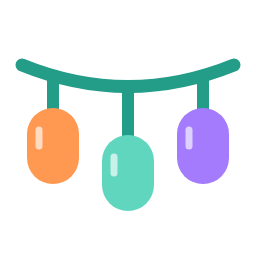

# Festavia Studio



A Home Assistant custom integration for Philips Hue Festavia lights. Create an
ordered palette, repeat one color per puck, animate it, and use it in ordinary
Home Assistant automations. Your lights remain on their Hue bridge.

Version **0.13.0** runs directly inside Home Assistant. **No add-on, web app, iframe,
YAML package or separate dashboard is required.** An optional custom card makes
palette editing visual. This is independent community software.

## Snake over a background

In the existing card, choose **Snake over background**. Set **Background colors**
for the fixed pattern, then add and edit **Snake colors** for the moving block.
The background returns in place after the snake passes. Direction and Speed
control the movement; each chosen snake color occupies one puck at a whole step.
Intermediate frames blend smoothly. Both layers share the main brightness control.

The pattern repeats in at most nine puck positions. Its length is the largest
multiple of the background palette count that fits nine slots (three background
colors give nine positions; four give eight). Leave at least one background puck
between snakes. The card shows the repeat and gap. On a 27-puck fixture this gives
several repeated snakes, rather than one isolated snake across the entire string.
It never animates the fixture's configuration map.

Use **Palette to save** to save either layer as ordinary colors. Each layer also
has its own saved-palette selector. A **Scene** saves both layers and movement.
HA actions accept `effect: snake`, `colors: [...]` for the background and
`snake_colors: [...]` for the moving block; palette actions accept
`layer: background` or `layer: snake`.

## Install and connect

Start with the [installation guide](docs/INSTALL.md) for the Home Assistant
download, guided USB setup on Windows/macOS/Linux, private connection-file import, and ordinary wireless updates.

Requires Home Assistant **2026.10 or newer**, a square Hue Bridge or Bridge Pro,
and Festavia lights already paired to that bridge. HA Container and HAOS are
supported; Supervisor is not required. Bridge Pro is physically tested. The
original round bridge lacks the required local API v2 and is unsupported.

1. Extract the integration ZIP and copy `custom_components/festavia_studio` into
   your HA configuration's `custom_components` directory. Restart HA once.
2. Open **Settings → Devices & services → Add integration → Festavia Studio**.
3. Choose an existing HA Hue bridge, or enter another bridge's IP address and
   authorize it with its physical link button.
4. Select only the Festavia lights you want. Choose bridge gradients for static
   colors, or individual puck effects with an ESP32-C6.
5. For puck effects, upload the private connection file from the setup launcher.
   The integration guides Zigbee joining and verifies fixture identity, firmware
   and logical count.

A public repository is not yet published. The release is structured for a HACS
custom integration; it is not in HACS' default catalog or Home Assistant Core.
On HA 2026.11+, Marketplace replaces HACS. Once the repository is public,
**Settings → Marketplace → Add from link** is the intended installation path;
HA 2026.10 users can add it as a HACS custom repository. The integration and its
optional card are installed together. Manual ZIP installation works now.

## Use it in Home Assistant

Open the **Festavia Studio device** under the integration. Its controls work
without any custom card:

| Control | Behavior |
|---|---|
| Effect light | Standard `light.turn_on`/`turn_off`, brightness and effect controls |
| Palette | Ordered hex colors, such as `#ff0000, #00ff00, #9900ff`; one color per puck, repeated |
| Speed / Reverse direction | Adjust the animation while it runs |
| Color palette | Save/load ordered colors without changing the animation, speed, direction or brightness |
| Scene | Save/load the complete setup: colors, animation, speed, direction and brightness |
| Stop and restore | Restore the appearance captured before Studio playback |
| Brightness limit | Installation cap, under Configuration; persists across reloads |
| Allow Hue takeover | Native configuration switch: let Hue changes end Studio playback |
| Return control to Hue | Stop sending without restoring an old scene |
| Firmware | Standard HA update entity; installs the bundled verified ESP32 image over Wi-Fi |

Starting works when Hue already has the lights on, including above Studio’s
brightness limit. Native startup switches off before setting the effect level,
then turns on; bridge mode sends the requested brightness with its power-on update.
The limit applies to Studio effects; **Stop and restore** returns the
captured Hue appearance, including its previous brightness.

With **Allow Hue takeover** enabled, the ESP effect yields to Hue changes reported
by the bridge and to Home Assistant light commands. It stops sending without
restoring an older scene. Use **Return control to Hue** for an explicit handoff;
Studio starts again only when you press its playback switch.

The option is under the native device’s Configuration controls and under
Configure → Playback ownership. It defaults to on. A missed HA ownership heartbeat
for about ten seconds stops the effect on its current frame, allowing Hue to take
control. This includes HA restarts that exceed the lease. Disabling the option
keeps autonomous playback through HA restarts. Explicit Stop and restore remains
available; integration reloads also restore a still-owned session.

Hue reports state changes, not a complete command log. Repeating an identical
command in the Hue app may produce no event. A value that matches Studio’s
current colors or pulsing brightness can also be ambiguous because Hue reports
ESP output too. Use Return control to Hue in those cases, or change a light
setting outside the active output. HA light commands are detected separately,
including repeats. Extended retained static scenes emit no ongoing color updates,
so later Hue color events can yield even when they match a color in the palette.
Expected setup power and captured baseline reports are filtered
while Play is starting; matching Hue app commands can be ambiguous there too.
The automatic option applies to ESP native playback; bridge
mode sends static settings once and does not continually overwrite Hue.

After using a Hue gradient or special effect, choose a solid color or white in
Hue before starting native Studio playback. Arbitrary Hue effect snapshots cannot
be recovered by the native firmware; the integration reports this requirement
before changing the fixture.

Edits while off save your controls without turning on the lights. Edits while
playing update the running effect. Studio playback starts your saved controls. Save colors with **Festavia Studio: Save color palette**, or save a complete setup
with **Save scene**. Both actions are available in the optional card. Existing saved
items remain full scenes, with their colors and animations preserved. Configure offers
scene/palette removal and Zigbee status.
Use the integration menu's **Reconfigure** to change connections, fixtures or mode,
or to recover unfinished playback.
Diagnostics are available from the integration's normal download menu.

### Optional visual palette card

On your existing dashboard, choose **Edit → Add card**, search for **Festavia Studio**,
and select the Studio playback entity in its visual editor. The integration installs
the card resource automatically. No separate frontend download is needed.

For a YAML-managed dashboard, the equivalent card is:

```yaml
type: custom:festavia-studio-card
entity: sensor.festavia_studio_playback
title: Festavia
```

The integration registers the resource. Tap a numbered swatch to edit its color,
use the touch color wheel or quick colors, add/remove/reorder colors, choose an
animation and enable Studio playback. Save colors and full scenes separately. Edits save automatically.
For a large static palette, select **Static repeat**, then **Fill with spectrum**
to populate every puck with a different color. Tap any swatch to change it.
There is no additional app to open or synchronize. Native controls and the card
share the same saved state. After upgrading, refresh the HA page or reopen the
Companion app once to load the updated card.

| Animation | What it does |
|---|---|
| Static repeat | Repeat your exact ordered colors, one per puck |
| Smooth flow | Scroll the palette continuously |
| Step chase | Move by whole pucks, keeping your selected colors exact |
| Bounce | Scroll out and back |
| Color fade | Fade the entire fixture through the palette together |
| Color wave | Move a rolling wave of palette colors |
| Breathing | Fade the repeated colors up and down |
| Heartbeat | Pulse the repeated colors twice per cycle |

In YAML-managed dashboards, add the module resource
`/festavia_studio/festavia-studio-card.js` to your dashboard resources manually.

## Compatibility and automatic sizing

| Mode | Sizing | Support |
|---|---|---|
| Hue bridge gradient | Reported API gradient color points across selected strings | Static ordered palettes; points may blend across multiple physical lights |
| ESP32 individual pucks | Automatically reads the actual count and checks Hue metadata and full map coverage | LCX030 Permanent / firmware 1.163.5; Any detected count from 1 through 48, including cut strings. Physical regression on 27 positions |

Native mode detects **any installed count from 1 through 48 pucks** and supports
one ordered static color per puck. This is a continuous range, not a list of
supported pack sizes: 7, 19, 27, 43 and every other count in that range use the
same setup. No manual kit-size setting or size-specific image is needed.
Setup reads the fixture count, original geometry and region capacity; it checks
Hue’s reported pixel count when available. Cut strings use their detected length.
After physically cutting or extending a configured string, use the integration’s
**Reconfigure** flow to discover its new length. Firmware **0.4.0** is required
for the expanded renderer; paired devices update wirelessly through the Firmware
entity. Other Festavia models or fixture firmware versions remain capability-gated.

Setup, playback, saved palettes and the mobile editor are tested for **every
count from 1 through 48**. The available physical installation reports 27. Other lengths
have not been physically tested here. Please include model, firmware and detected
count when contributing hardware results.

The custom card and HA actions edit the full detected palette. HA text states have
a 255-character limit, so the native Palette text entity shows an instruction to
use the card when a palette exceeds that length.

A finite series of full-coverage layouts applies colors to individual pucks,
then restores and verifies Hue's original layout and addresses. The lamp
holds the pattern without repeated map writes. Applying a large static palette
takes several seconds; initial discovery/setup takes longer. It updates in
sections rather than appearing everywhere at precisely the same instant.

Single-palette animations support **1–9 ordered colors** and up to **10 requested
updates per second**: smooth flow, step chase, bounce, color fade, color wave,
breathing and heartbeat. Snake over background combines two palettes into at
most nine repeating positions, as described above. All retain the native FC03
transport; its nine-slot limit is unchanged.
The card disables animations for larger palettes. Continuous remapping for
high-count animation is not enabled because its persistence/write behavior is
unverified. See [research and evidence](docs/RESEARCH.md#retained-individual-colors).

Brightness/tone is shared across
native palette colors. Native colors must be non-black and have equal RGB maximum
values; unsupported palettes are rejected immediately with an HA error. The encoder does not support independent arbitrary puck
dimming in this mode. The card maintains a shared tone when editing colors.
One ESP32 controls one native fixture at a time. Bridge mode may select multiple
Festavia strings, with sequential writes. Native multi-fixture synchronization
is not claimed.

Other quantities are read from each fixture, never hard-coded to the test house.
Other model/firmware combinations need mapping verification before native mode
is enabled. Marketing LED count, gradient points and native logical count are
separate quantities. Renaming another Hue product “Festavia” does not qualify it.

## First ESP32 installation

Use an **ESP32-C6, 4 MB flash or larger, with UART0 USB-to-serial access**. Other
ESP32 families are not interchangeable with its 802.15.4 radio. First installation
needs USB once; routine updates retain Wi-Fi, TLS identity and Hue network and
use the HA firmware entity. Keep the board powered during an update.

The full source release includes `tools/first-install.py` and pinned USB
requirements. On the USB computer, create a Python environment, install
`requirements-usb.txt`, and run:

```sh
python tools/first-install.py --port /dev/ttyUSB0 --ssid 'Your Wi-Fi'
```

The tool asks before first flashing, prompts privately for the Wi-Fi password,
checks bundled image hashes and verifies HTTPS against the USB certificate pin.
It saves a private device connection file. Enter its `url`, `token` and
`tls_sha256` into the integration. Do not publish that file. Use a data cable;
BOOT held while tapping RESET can enter flashing mode when necessary.

For Zigbee joining, Hue's **Add lights → Search** opens the joining window.
The API link button authorizes bridge access; it does not open Zigbee joining.
Do not reset or remove the Festavia from Hue.

## Actions and automations

All visual edits use the same native actions. Examples:

```yaml
action: festavia_studio.set_palette
data:
  colors: ['#ff0000', '#00ff00', '#9900ff', '#ffff00']
```

```yaml
action: light.turn_on
target:
  entity_id: light.festavia_studio_effect_light
data:
  brightness_pct: 10
  effect: flow
```

Additional actions: `configure`, `play`, `load_palette`, `save_palette`, `delete_palette`,
`load_scene`, `save_scene`, `delete_scene`, `stop`, `off`. Legacy `load_preset` and
`save_preset` remain aliases for complete scenes.
When multiple Studio entries exist, supply `entry_id` for Studio actions. Standard
light/text/number/select/switch actions use ordinary entity targets.

## Troubleshooting and removal

If unavailable, check local HTTPS reachability from HA to bridge and ESP32,
then Reconfigure. A certificate change requires verification and updated connection
settings; TLS checks are not silently disabled. A light selection must still be
present in the current bridge inventory and be a Festavia product. Native setup
rejects unverified firmware/mapping combinations rather than guessing.

If a captured light was permanently removed or replaced in Hue, use
**Reconfigure → Recover removed lights**. Explicit confirmation restores every
captured light still present and discards recovery only for missing Hue resource
IDs. Then reconfigure the selection to choose replacements. An offline light
still present in Hue is retained for recovery.

Use **Stop and restore** before replacing fixtures or changing mode. The integration
refuses selection changes while a recovery lease exists, including when the entry
is unloaded. The effect light reports Studio playback ownership; its off state does
not mirror a Hue light switched on independently. Turning the effect light off
switches the selected lights off. Stop and restore restores the captured appearance
and respects an external power-off.

Reload and removal drain pending actions and restore playback. If a reload
cannot reach the device, HA retries setup and restores the retained lease on
reconnection, without getting stuck in Failed unload. Online removal
cleans private state and the optional card resource when the last entry is removed.
If restoration cannot be confirmed, **Settings → System → Repairs** keeps a
persistent Festavia recovery notice, including after an HA restart. Reconnect the
original equipment. If the entry still exists, use **Reconfigure → Recover
playback** or reload it; connection changes belong in **Reconfigure → Connection**.
If removed, **add Festavia Studio again**, select the original bridge/lights and
confirm recovery when offered. Updated credentials can be entered during setup.
The notice clears only after recovery. It deliberately offers no generic Repair
confirmation when the component is unloaded. Do not manually delete recovery
files before restoration. Remove any card you added yourself, then the component
files. Removing the integration does not reset or unpair Hue lights or the ESP32.

When connected through an existing HA Hue integration, Studio follows that entry's
renewed key and changed address after verifying bridge identity and certificate.
Manual authorization stays independent. Authentication failures start HA's normal
reauthentication flow. A manually entered replacement Hue key detaches automatic
key following; choose the Hue integration again in Reconfigure to reconnect it.
Bridge hostnames are accepted when all DNS answers are private LAN/Tailscale IPs.
A DHCP reservation for both bridge and ESP32 is still useful.

The old experimental companion cannot be migrated automatically from an arbitrary
installation. Its private installation, device credentials, palettes and journals
must first be copied into `.storage/festavia_studio/<entry_id>/` by an administrator
while the companion is stopped. The schema-1 migration then retains registry IDs.
A missing private installation fails migration without discarding the old entry.
Fresh installations use only the native flow described above.

## Development and contribution

See [HA design research](docs/HA_DESIGN.md), [acceptance results](docs/ACCEPTANCE.md), [contributing](CONTRIBUTING.md),
[third-party notices](THIRD_PARTY_NOTICES.md), and [research](docs/RESEARCH.md).
The firmware image/source manifest is checksum verified during packaging.
Tests cover the actual HA runtime with simulated transports and separately cover
protocol encoding, collision detection, restoration, OTA and mobile card behavior.
Hardware acceptance is documented separately from simulated coverage. No HA
Integration Quality Scale tier or Core/HACS acceptance is claimed.
