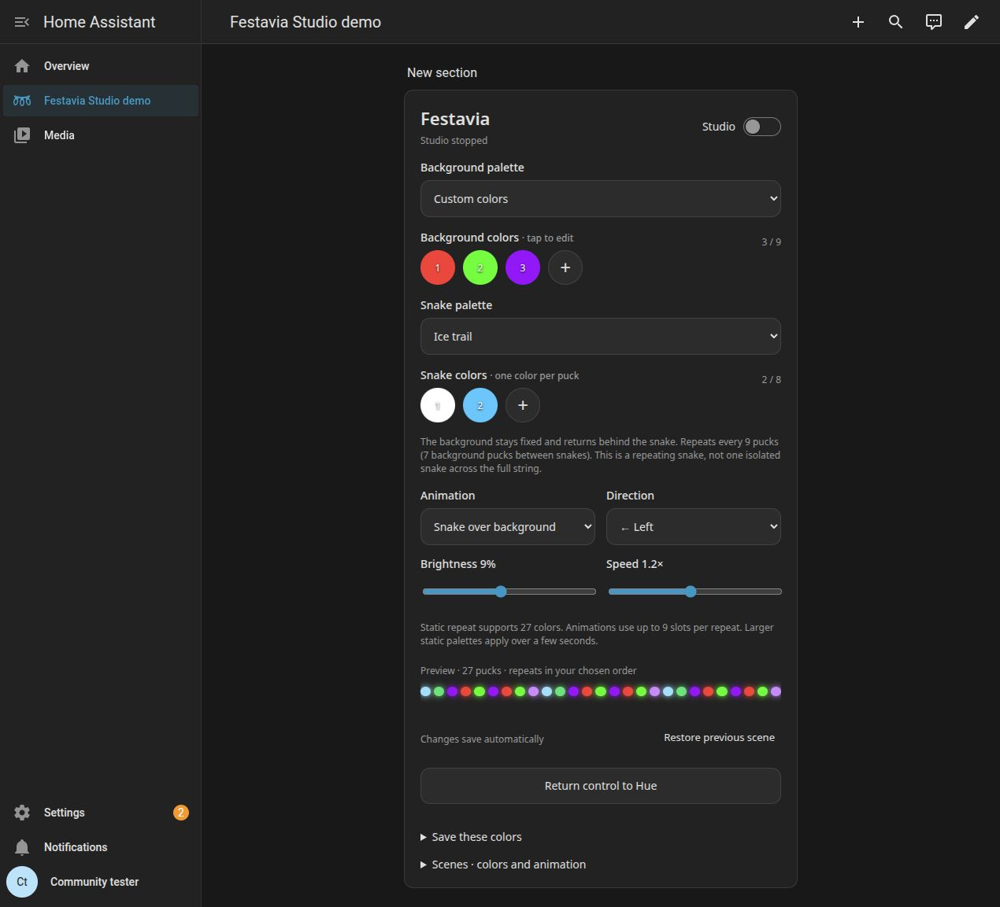
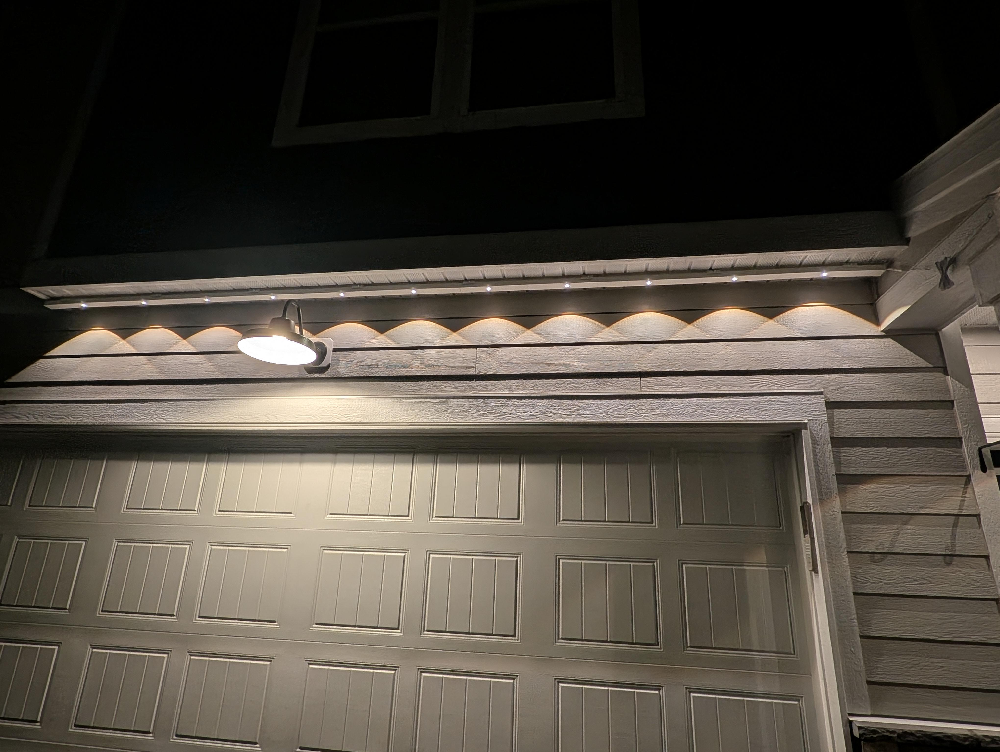

# Festavia Studio & Track

**Festavia Studio** controls the colors and movement of your Philips Hue Festavia lights. **Festavia Track** is a printable soffit mount for Festavia permanent outdoor pucks. Use either project on its own, or mount a run with Track and light it with Studio.

| Control the lights | Mount the pucks |
| --- | --- |
|  |  |
| [Set up Home Assistant](docs/INSTALL.md) · [Use the Hue app](hue-direct/GETTING_STARTED.md) | [Customize on MakerWorld](https://makerworld.com/en/models/3665672-festavia-track-modular-soffit-mount-for-hue) · [Download the complete track kit](https://raw.githubusercontent.com/Dyluhn/festavia-studio/track-downloads/v0.1.1/Festavia-MakerWorld.zip) |

## Festavia Studio

Build a palette in order, choose an effect and save it as a scene. Keep a red and green background fixed, for example, and send a white snake across it. Each puck returns to its background color as the snake passes. The lights stay paired to your Hue bridge.

### Set up in Home Assistant

1. **Choose your controls.** For static Hue gradients, start with Home Assistant 2026.10 or newer, a square Hue Bridge or Bridge Pro, and Festavia lights already paired to it. For individual puck colors and animations, add an ESP32-C6 with at least 4 MB flash and USB-to-UART access. Native effects support the Festavia Permanent LCX030 on firmware 1.163.5. [Hardware compatibility](docs/COMPATIBILITY.md)
2. **Install Studio.** On HA 2026.11+, use **Settings → Marketplace → Add from link**. On HA 2026.10, add `https://github.com/Dyluhn/festavia-studio` to HACS as an **Integration**. Enable prereleases for **v0.13.0**. For manual installation or first-time C6 setup, choose the ZIP in the [installation guide](docs/INSTALL.md).
3. **Connect and play.** Open **Settings → Devices & services → Add integration → Festavia Studio**. Select your bridge, lights and mode. For a new C6, run the **Setup Home Assistant** desktop launcher over USB and import its private connection file when prompted. On the Studio device, set a palette and enable playback. Routine controller updates run over Wi-Fi.

For a visual color picker, open your dashboard and choose **Edit → Add card → Festavia Studio**. Tap a numbered swatch to change its color. Save a **palette** to reuse the colors or a **scene** to recall the colors, effect, speed, direction and brightness together. [See the controls and examples](docs/UI_GUIDE.md#home-assistant)

### Use the Hue app instead

Download **festavia-direct-0.5.1.zip** from the Studio release for a dedicated ESP32-C6. Extract it, connect the C6 by USB and start the **Setup** launcher for your computer. Select the existing Hue bridge and Festavia fixture. The installer creates a **Festavia Direct** zone and a preset scene. Open that zone in Hue to adjust the controls and recall scenes. Each C6 runs one controller edition at a time. [Hue-only setup](hue-direct/GETTING_STARTED.md) · [Hue controls in pictures](docs/UI_GUIDE.md#hue-only-with-festavia-direct)

Native controller modes read the fixture’s actual puck count. Static palettes can use one color per detected puck, up to 48. Animations use up to nine repeating positions. [Full Studio guide, automations and troubleshooting](STUDIO.md) · [Software downloads](https://github.com/Dyluhn/festavia-studio/releases/tag/v0.13.0)

## Festavia Track

Build a straight run to fit your eaves and printer. Track holds each puck in a locking ring. Numbered sections join on the bench, then lift into sliding-lever soffit brackets. The mount works with the factory Hue setup and needs no controller or Home Assistant installation.

1. **Measure.** Measure cap face to cap face along each straight side. Choose the puck spacing and enter your usable printer bed dimensions. Check the holder against your permanent puck, about 35 mm across with 49 × 20 mm mounting tabs. [Illustrated configuration guide](track/docs/Festavia-Configuration-Guide.pdf)
2. **Design.** On MakerWorld select **Customize**, then choose **Festavia-Run** for a complete layout or **Festavia-Section** for a fit coupon or replacement. Select **Generate**, inspect **Assemble View** and download the plates. To work offline, extract the complete kit and open `workbench/index.html`. [MakerWorld walkthrough](track/makerworld/README.md)
3. **Print and mount.** Keep the parts at 100% scale. For the reference PETG setup, use the built-in breakaway ribs on track sections and tree supports on bracket and lever plates. Lock each puck, pin the seams and close the bracket levers. For cable slack or the power supply, choose the optional boxes, covers and clips in **Festavia-Accessories**. [Assembly picture manual](track/docs/Festavia-Assembly-Manual.pdf) · [Accessory parts and fasteners](track/accessories/README.md)

The included 15 ft example uses 16 in puck spacing on a 256 mm square bed. It produces **11 puck positions, 27 sections and 12 plates**. Change the measurements to generate your own layout. [Track source, settings and desktop exporter](track/README.md)

## Help and contributions

[Studio troubleshooting](STUDIO.md#troubleshooting-and-removal) · [Track fit and assembly](track/docs/ASSEMBLY.md#fit-first) · [Report an issue or a fit result](https://github.com/Dyluhn/festavia-studio/issues/new/choose) · [Contribute](CONTRIBUTING.md)

Independent community projects for Philips Hue Festavia. [Studio license](LICENSE) · [Track license](track/LICENSE)
