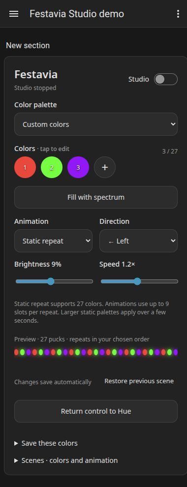
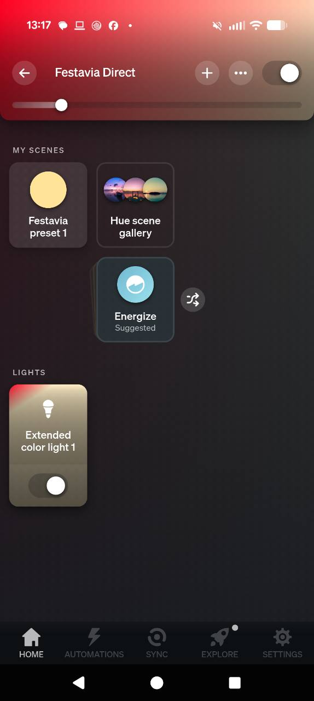

# Festavia Studio & Track

Use **Studio** to control the colors on Philips Hue Festavia lights. Use **Track** to print a mount for Festavia permanent outdoor pucks. You can use either project on its own or use both on the same installation.

## Start with a picture guide

| I want to… | Follow this guide |
| --- | --- |
| Control the lights in **Home Assistant** | [Install Studio, connect Hue and make your first palette](docs/INSTALL.md). Choose bridge gradients or add an ESP32-C6 for individual puck effects. |
| Control the lights in the **Hue app** | [Set up Festavia Direct and save a three-color preset](hue-direct/GETTING_STARTED.md). A dedicated ESP32-C6 runs the effects. |
| **Print and mount a track** | [Measure, design, print and install a run](track/README.md#build-your-first-run). Use the online customizer or the offline workbench. |
| Add **boxes and cable clips** | [Choose, print and fit the cable box, supply cradle and clips](track/accessories/README.md). Each accessory can be used independently. |

## Festavia Studio

Studio keeps your lights on their existing Hue bridge. In Home Assistant, tap numbered swatches to choose colors in order, then save a palette or save the whole animation as a scene. In Hue, open the **Festavia Direct** zone and use its named controls to edit or recall a preset. Choose one controller edition per ESP32-C6.

| [Home Assistant walkthrough](docs/INSTALL.md) | [Hue app walkthrough](hue-direct/GETTING_STARTED.md) |
| --- | --- |
|  |  |

**Already installed?** [Edit, animate and save colors in Home Assistant](docs/UI_GUIDE.md#home-assistant) · [Use the Hue controls and scenes](docs/UI_GUIDE.md#hue-only-with-festavia-direct) · [Studio software downloads](https://github.com/Dyluhn/festavia-studio/releases/tag/v0.13.0)

## Festavia Track

Measure one straight eave from cap face to cap face. The planner uses your run length, puck spacing and printer bed to lay out the numbered pieces. A 15 ft run at 16 in spacing on a 256 mm square bed gives 11 puck positions, 27 sections and 12 plates. The assembly guide shows how to lock each puck, pin the seams and lift the finished run into the soffit brackets.

[Design on MakerWorld](track/makerworld/README.md#try-it-online) · [Use the offline workbench](track/workbench/README.md) · [Print and assemble](track/docs/ASSEMBLY.md) · [Download the complete track kit](https://raw.githubusercontent.com/Dyluhn/festavia-studio/track-downloads/v0.1.1/Festavia-MakerWorld.zip)

## Help and contributions

[Studio compatibility](docs/COMPATIBILITY.md) · [Studio user guide and troubleshooting](STUDIO.md) · [Track fit checks](track/docs/ASSEMBLY.md#fit-first) · [Report an issue or fit result](https://github.com/Dyluhn/festavia-studio/issues/new/choose) · [Contribute](CONTRIBUTING.md)

Independent community projects for Philips Hue Festavia. [Studio license](LICENSE) · [Track license](track/LICENSE)
