# Festavia Studio: a visual walkthrough

Two editions keep your Festavia on its existing Hue bridge:

- [Home Assistant](#home-assistant): native entities, automations and an optional
  visual palette card on your existing dashboard.
- [Hue-only with Festavia Direct](#hue-only-with-festavia-direct): a separate C6
  firmware edition that maps settings onto the Hue app's existing light controls.

Install one edition on a controller at a time. Both detect the actual fixture
length from 1 to 48 pucks. Native control currently qualifies LCX030 / fixture
firmware 1.163.5. Physical qualification is one 27-puck installation on BSB003;
other quantities and BSB002 have software coverage and need community hardware
reports. See [compatibility](https://github.com/Dyluhn/festavia-studio/blob/main/docs/COMPATIBILITY.md).

[Download the 12-page illustrated PDF](ui/Festavia-Studio-UI-Walkthrough.pdf).
The images below are actual interfaces: eight HA captures use simulated peers
with the unmodified 0.13.0 integration; four Hue screenshots were supplied by the
project owner. The HA capture session did not command real lights; the Hue
images document the owner's actual setup.

## Home Assistant

### Choose your colors in order

Add the optional **Festavia Studio** card to your existing dashboard. Select its
Studio playback entity in the visual editor. The integration installs the card
resource; it needs no separate web app or frontend download.

1. Select **Static repeat**.
2. Tap **+** to add colors. Tap a numbered swatch to edit it.
3. Pick three colors for `1, 2, 3, 1, 2, 3…`, or four for `1, 2, 3, 4, 1, 2…`.
4. Set brightness and enable **Studio** to apply the layout. Edits made while
   stopped save settings without starting the lights.

The preview uses the detected count. Its `3 / 27` label means three chosen colors
out of a 27-color static capacity on this demo fixture. A different installed
length changes that capacity automatically. A large static palette applies over
a few seconds, in sections.

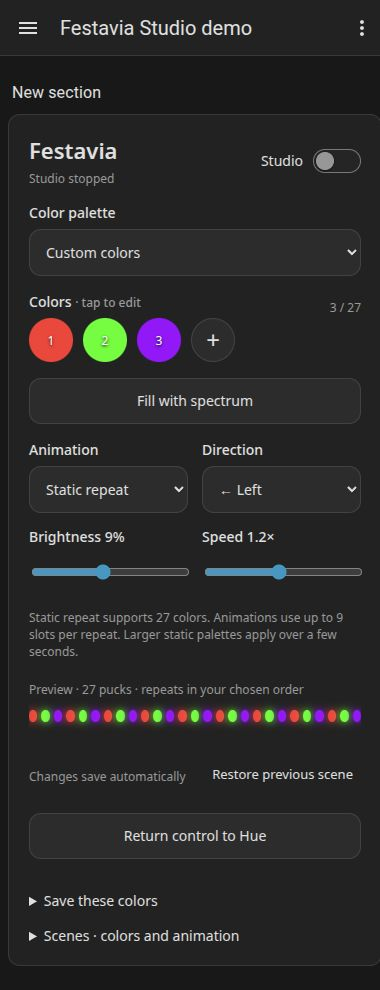

### Edit and reorder a color

Tap a swatch to open the color editor. Choose a point on the wheel or a quick
swatch; refine hue and saturation, or expand **Advanced color** to enter a hex
value. **Move** changes the color's position in the sequence; **Remove** deletes
it. Tap **Done** to close the editor. Changes save automatically.

**Shared palette tone** changes the palette's shared tone. The main **Brightness**
control sets output. Native colors share brightness; independent arbitrary
dimming of each puck is not supported.

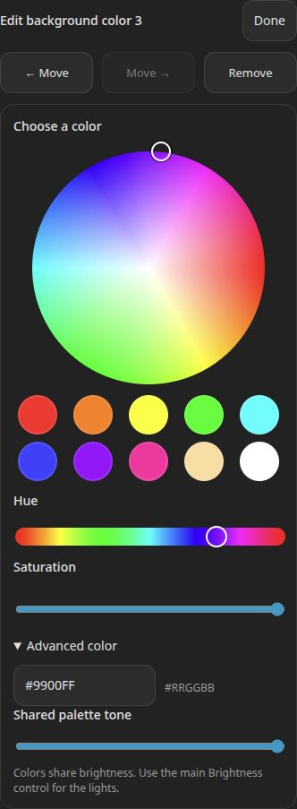

### Give the snake its own colors

Choose **Snake over background**. Set the stationary pattern with **Background
palette** and **Background colors**, then edit **Snake palette** and **Snake
colors** independently. The original background returns behind the moving trail.
Adjust **Direction** and **Speed** while it runs.

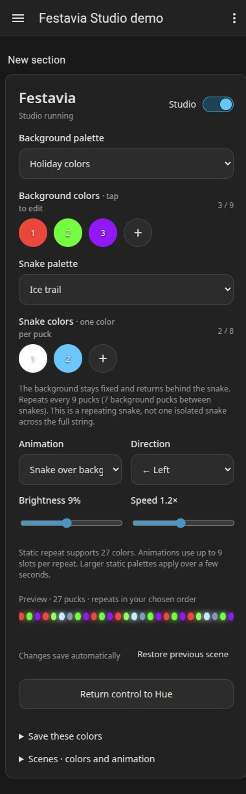

This recording shows the card's moving preview:

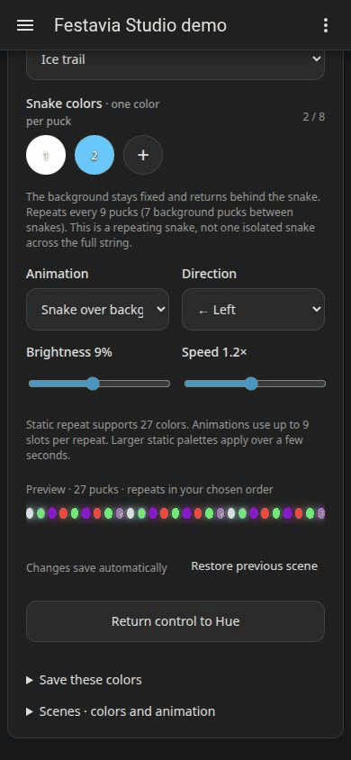

The preview illustrates the pattern; it does not measure physical playback
smoothness or radio delivery. The snake repeats within at most nine positions;
it is not a single isolated trail across all 48 pucks. The card states the actual
repeat length and the gap between trails. Up to 48 distinct retained static
colors and up to nine repeating animation slots are separate capabilities.

Other modes include **Smooth flow**, **Step chase**, **Bounce**, **Color fade**,
**Color wave**, **Breathing** and **Heartbeat**. Step chase moves by whole pucks;
Smooth flow blends between positions.

See the native effect menu

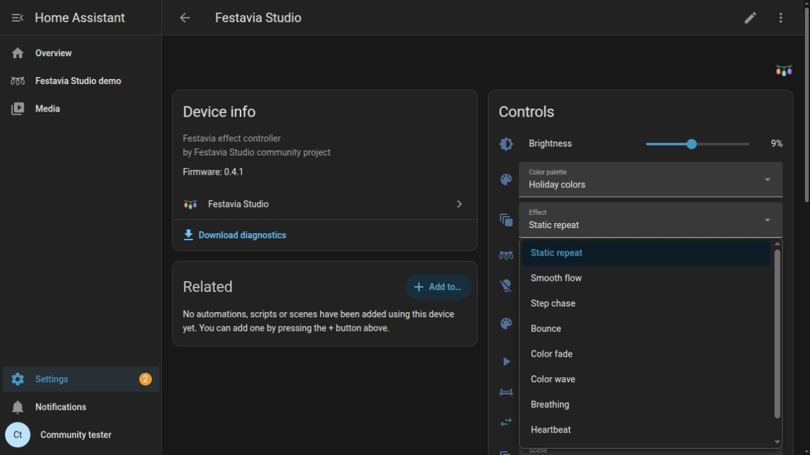

The capture shows the visible portion of the menu. Snake is below the fold.

### Save colors or save the whole look

| Save control | What it stores |
|---|---|
| **Save these colors → Save palette** | Ordered colors only. Loading it keeps the current animation, speed, direction and brightness. In snake mode choose which layer to save. |
| **Scenes · colors and animation → Save scene** | The complete setup, including both snake layers, animation, speed, direction and brightness. |

Choose a saved palette from the relevant palette selector, or recall a complete
look from **Saved scene**. A palette and a scene are intentionally different.

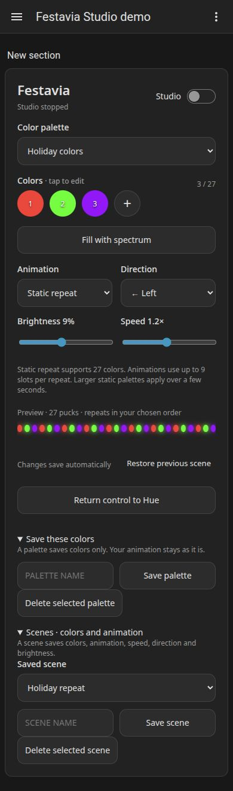

### Use normal Home Assistant controls

Open **Settings → Devices & services → Festavia Studio**, then its controller
device. Standard HA entities expose brightness, effect, speed, palette, scene,
playback and firmware updates. Use them in automations or your own dashboard;
the custom card is optional.

**Allow Hue takeover**, under Configuration, lets supported Hue changes end
Studio playback. **Return control to Hue** releases output manually without
restoring an older scene. **Stop and restore** returns the captured previous
appearance. These are different actions.

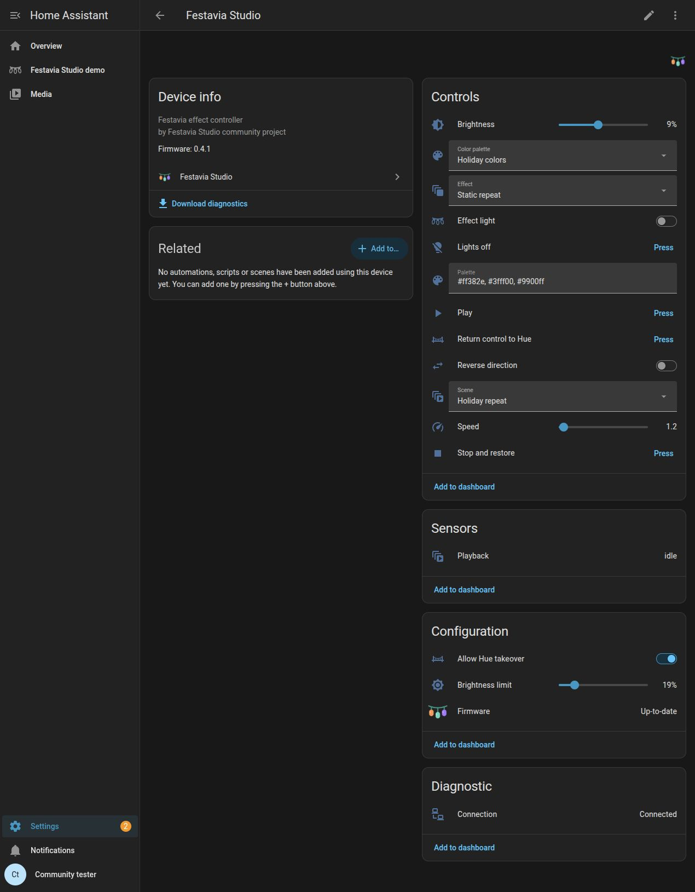

Desktop card and integration overview

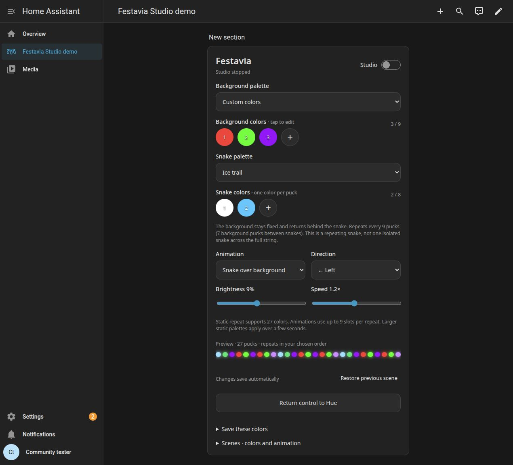

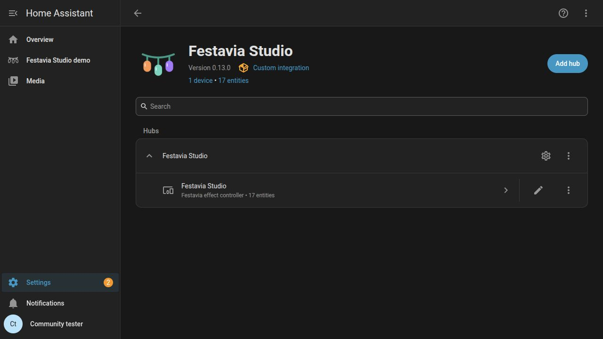

[Install the Home Assistant edition](https://github.com/Dyluhn/festavia-studio/blob/main/docs/INSTALL.md).

## Hue-only with Festavia Direct

### Start from the Festavia Direct zone

The Direct installer creates the control zone and an initial preset scene.
Open **Festavia Direct** in Hue. Recall **Festavia preset 1** to load the saved
program. The C6 runs playback; HA and the setup computer are not needed for
daily use.

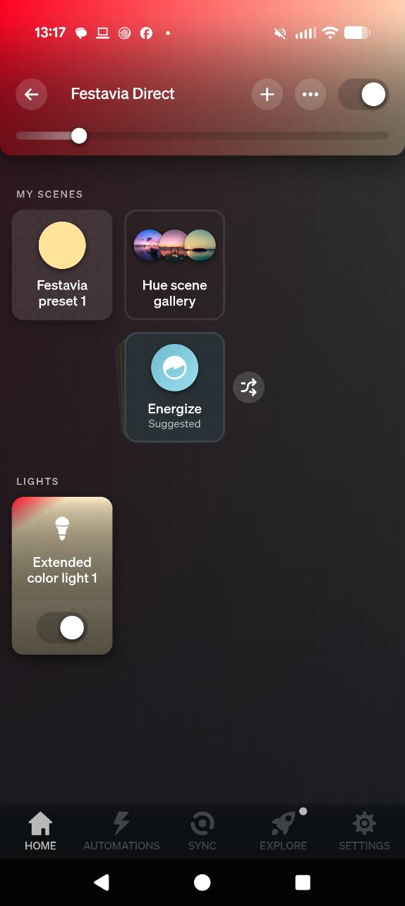

The virtual lights are **parameter controls**. They are not one Hue light per
puck. The real Festavia remains in its original Hue room. The app may show
**Extended color light 1** as a generic name: read the smaller **Festavia · Master**,
**Festavia · Colour**, etc. role labels. Scroll the bottom row horizontally to
reach all roles. Hue's grouped tiles and color-wheel pins are not the detected
puck count.

Keep parameter controls on so Hue enables their sliders. **Only Master starts
or stops actual output and controls real brightness.** A percentage on another
role represents a setting value. Select that individual role before editing;
avoid changing the whole control zone together.

### Pick the layer, position and color

For a repeating three-color palette, keep **Master off** while editing:

1. On **Preset / Apply**, select preset slot 1 with **1%** before editing.
2. On **Palette**, choose the coldest white position for the background layer,
   then set its brightness to **3%** for three colors.
3. On **Position**, set brightness to **1%**. On **Colour**, choose the first color
   using the normal Hue wheel.
4. Repeat with Position **2%** and **3%** for the other colors.
5. On **Motion**, choose the coldest white position for Static. Save using
   **Preset / Apply → 50%**, let the slider settle, then start Master at a low
   brightness such as **9%**.

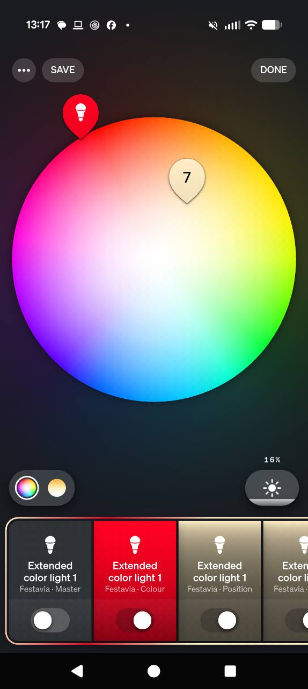

### Turn the palette into a moving snake

Keep those background colors, and turn Master off while setting the next layer.
On **Palette**, choose the middle white position for the snake layer and set
brightness to **2%** for two trail colors. Use **Position 1% / 2%** and **Colour**
to edit them. On **Motion**, choose Snake near **2200 K** and set brightness to
**5%** for normal speed or **10%** for double speed. Set **Direction** to **1%**
for left or **100%** for right. Save with **Preset / Apply → 50%**, then enable
Master. The background returns after the trail passes.

The screenshot shows the role tiles. Open each individual role to use its own
sliders. The stock Hue app cannot display custom parameter names beside those
sliders; the mapping is:

| Role | Existing Hue control | Meaning |
|---|---|---|
| Master | On/off; brightness | Playback; real output brightness within the cap |
| Colour | Color wheel | Color at the selected layer and position |
| Position | Brightness 1–48% | Literal index; 27% means position 27 |
| Palette | White temperature; brightness | Cold: background; middle: snake; warm: individual. Brightness sets the background/snake color count. |
| Motion | White temperature; brightness | Effect; speed (5% = 1×, 10% = 2×) |
| Direction | Brightness | Below 50%: left; 50% or above: right |
| Shape | White temperature; brightness | Select a shape/device parameter; set its value |
| Preset / Apply | Brightness | Recall a slot or execute a save/apply command |

For a distinct retained color on every puck, select Palette's warm **individual**
layer and Motion's warm **Individual** mode. Edit positions up to the detected
count, at most 48. Animated modes still use up to nine repeating color slots.

### Adjust shape and save a complete preset

**Shape** selects width, span, phase, brightness cap, smoothing or Hue takeover
with the white-temperature slider. Brightness sets the selected parameter.
The [full Hue control reference](https://github.com/Dyluhn/festavia-studio/blob/main/hue-direct/README.md#daily-use-in-the-hue-app)
lists the exact selector positions for Shape and all ten Motion modes.

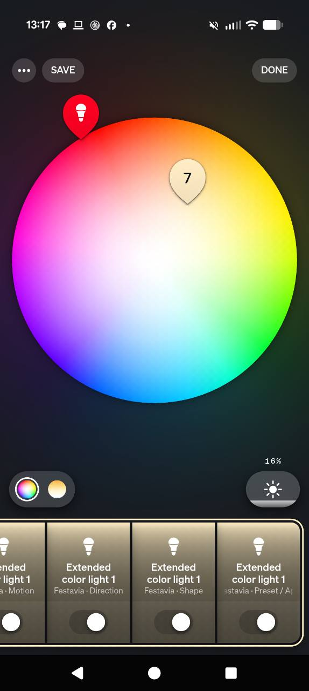

| Preset / Apply brightness | Action |
|---|---|
| 1–16% | Select and recall a saved preset slot |
| 25% | Apply staged edits |
| 50% | Save the current program to the selected slot |
| 75% | Load the selected slot |
| 100% | Save and apply |

Let the slider settle and return to its preset-slot value. A controller preset
saves colors **and** animation settings. To make another normal Hue scene,
recall the desired saved slot, turn Master on, wait for readback, then save the
scene in the control zone. Hue's **SAVE** button saves that Hue scene; it is
separate from the controller's preset-save command. Keep Hue dynamic scene
playback off for these control scenes because the C6 supplies the animation.

With Hue priority enabled, commands to the **real Festavia** can make Direct
yield. Use Master off to stop and restore the captured pre-playback appearance.
The stock Hue edition exposes these settings through ordinary Hue controls;
the HA edition provides the visual editor shown above.

[Install the Hue-only edition](https://github.com/Dyluhn/festavia-studio/blob/main/hue-direct/GETTING_STARTED.md).

## Capture details

Home Assistant screenshots and the GIF show the released 0.13.0 interface with
simulated device/bridge peers. The GIF is a short loop of captured frames;
its loop boundary may jump. It is not a camera recording of the fixture.
The four Hue screenshots are unchanged originals supplied by the project owner.
Their phone status bars remain visible. No credentials, household photographs,
private setup files or backend logs are included.

The PDF carries the same distinction on its pages. Screenshots document the UI
as of November 11, 2026; they do not expand the supported hardware or animation
limits. This is independent community software, not an official Hue product.
