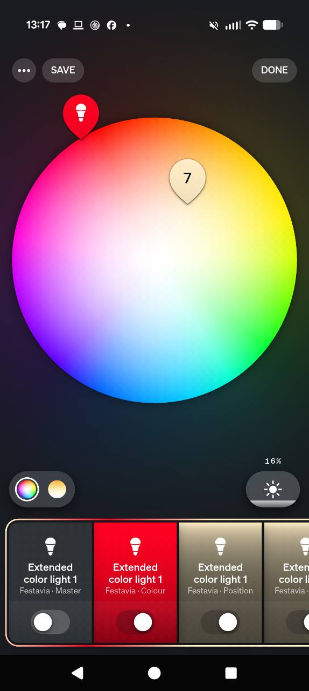

# Festavia Direct — Hue-only edition (experimental 0.5.1)

An ESP32-C6 runs the Festavia renderer and exposes ordinary color lights on your
existing Hue bridge. Edit their sliders/color pickers and recall Hue scenes. No
Home Assistant, browser app, computer process, cloud service, or ongoing host
heartbeat is required after commissioning. The actual Festavia stays paired to
Hue. This is a separate firmware edition; it does not replace the HA integration.

## See the Hue controls



These are virtual setting controls in the stock Hue app. **Master** sets actual
output; **Colour**, **Position**, **Palette**, **Motion**, **Direction**, **Shape**
and **Preset / Apply** edit the program. Scroll the bottom row and read the small
role labels under Hue's generic light name. They do not represent separate pucks.

[Follow the screenshot walkthrough](../docs/UI_GUIDE.md#hue-only-with-festavia-direct)
or [open the illustrated PDF](../docs/ui/Festavia-Studio-UI-Walkthrough.pdf).
The Hue captures were supplied by the project owner; the HA examples use demo data.

## Compatibility and limits

- ESP32-C6 with at least 4 MB flash and a USB-to-UART interface for first setup;
  Wi-Fi and Zigbee must both reach the bridge. Native-USB-only boards need a UART
  adapter with this image.
  A plain ESP32/WROOM has no Zigbee radio. H2 is not supported by this edition.
- Currently gated to Festavia **LCX030 / firmware 1.163.5**. Other model/software
  combinations are rejected before fixture writes. This is deliberately narrower
  than a claim to support every product sold under the Festavia name.
- Automatically reads the actual puck count: **any count from 1 to 48**, not only
  16/32/48. Packet/recovery programs are cross-tested across that whole range.
- Physical qualification: one **27-puck LCX030**, C6, **Hue Bridge Pro BSB003**.
  Square BSB002 and other physical puck counts still need community validation.
- Ten modes: Static, Flow, Chase, Bounce, Color fade, Wave, Breathe, Heartbeat,
  Snake, Individual. Direction, speed, phase, smoothing, snake width/span and
  separate background/foreground palettes are configurable.
- Static/Individual can retain **48 distinct indexed puck colors**. Animation
  uses the lamp's native bank of **up to 9 colors**, repeated across its length.
  The indexed editor does not turn this into 48 independently animated channels.
- One target fixture per C6. Multiple units are separate controllers/preset banks.
- 16 complete presets in C6 NVS: colors **and** animation settings. Hue scenes
  recall these presets. Presets are not merely named color palettes.
- Eight required virtual lights. The test bridge exposed eight; a ninth optional
  Apply/Save endpoint is advertised but not required. This is not a claim that
  eight is the universal Hue endpoint limit. Virtual lights consume bridge space.

## Install once

**Start with [the first-time setup guide](GETTING_STARTED.md).** Extract the
standalone ZIP and open **Setup Windows.cmd**, **Setup macOS.command**, or
**Setup Linux.sh**. The guided installer prepares dependencies, discovers ports
and bridges, offers compatible Festavias by name and creates the Hue controls.
It saves progress outside the downloaded package for wireless continuation and
updates. Python 3.10+ is required; the guide includes drivers and recovery steps.

For a terminal, run `python hue-direct/bootstrap.py` from the extracted folder.
Choose **New** only for a C6 you intend to flash; **Continue**, **Update** and
**Check** work with the saved controller. For the original manual CLI workflow:

```sh
python -m venv .venv
# Linux/macOS: source .venv/bin/activate
# Windows: .venv\Scripts\activate
python -m pip install -r requirements.txt
python hue-direct/install.py --port YOUR_SERIAL_PORT --ssid YOUR_WIFI_NAME
python hue-direct/commission.py --device-credentials festavia-device-credentials.json --bridge YOUR_BRIDGE_LAN_IP
```

Use a 2.4 GHz Wi-Fi network. The first step asks for the Wi-Fi password privately. Factory flashing replaces
settings on this ESP32. Use a data cable, C6 board, and its UART port. Keep the
credentials JSON private; each device generates its own TLS identity and token.
A first-install image contains no household Wi-Fi credentials, enrolled Zigbee
network keys or Hue API keys.

Commissioning asks you to press the Hue link button, opens normal light search,
selects an open network on that bridge's Zigbee channel, joins the C6, verifies
fixture identity/count directly, pins the bridge certificate, names its controls,
and creates **one Festavia Direct zone and one working preset scene**. With
multiple Festavias use `--light HUE_V2_LIGHT_ID`; with several open networks use
`--extpan NETWORK_EXTENDED_PAN`. It preserves existing ESP32 network membership.
`--legacy` selects ZLL joining if an older bridge cannot commission using Z3.

The default installation brightness ceiling is **19%**. To deliberately allow a
higher ceiling, turn Master off and rerun commissioning with `--cap 100`. The
Shape cap remains adjustable within that installation ceiling. Commissioning
leaves the actual output off and does not change your existing Hue automations.
Reserve stable DHCP addresses for the bridge and C6. The enrolled bridge address
is stored on the C6; a changed bridge IP/certificate requires recommissioning
while Master is off. If only the C6 address changes, update the `url` field in
your private device-credentials JSON to its new HTTPS address. No reflash is needed.

## Daily use in the Hue app

Open the **Festavia Direct** zone. Its lights are controls; the actual Festavia
is still the ordinary light in its original Hue room. Keep the parameter controls
on so Hue enables their sliders. Only **Master** powers the real animation.
Do not add the control zone to entertainment areas.

| Hue light | Existing Hue control | Meaning |
|---|---|---|
| Master | Power; brightness | Start/stop; output percentage, limited by cap |
| Colour | Color wheel | Color for the selected Position and Palette layer |
| Position | Brightness 1–48% | Literal puck/palette index; e.g. 27% = position 27 |
| Palette | White-temperature slider | Cold = background; middle = snake; warm = individual |
| Palette | Brightness | Background color count 1–N, snake count 1–8; Individual always N |
| Motion | White-temperature slider | Ten modes in the order listed below, cold → warm |
| Motion | Brightness | Speed: 5% = 1×, 10% = 2×, range 0.2×–20× |
| Direction | Brightness | Below 50% = left; 50% and above = right |
| Shape | White-temperature slider | Select width, span, phase, cap, smoothing, Hue priority |
| Shape | Brightness | Value of that selected parameter; see below |
| Preset / Apply | Brightness 1–16% | Select and recall a saved preset slot |
| Preset / Apply | 25 / 50 / 75 / 100% | Apply / Save / Load / Save and apply |

Commands wait 750 ms after the slider stops moving, so dragging through Save
to Load cannot overwrite a preset. The command slider returns to its selected
1–16% preset slot. Wait for its readback before saving a Hue scene so the scene
captures the intended slot. Scene recall never executes a captured Save/Apply
command. If your bridge exposes the ninth Apply/Save light it provides the same
command values; it normally resets off.

White-slider positions are evenly spaced. Hue's stock controls have no custom
labels or numeric parameter widgets; use these reference points:

| Motion mode | Mirek | Approx. Kelvin |
|---|---:|---:|
| Static | 153 | 6536 |
| Flow | 192 | 5208 |
| Chase | 230 | 4348 |
| Bounce | 269 | 3717 |
| Color fade | 307 | 3257 |
| Wave | 346 | 2890 |
| Breathe | 384 | 2604 |
| Heartbeat | 423 | 2364 |
| Snake | 461 | 2169 |
| Individual | 500 | 2000 |

Hue priority and the installation ceiling apply device-wide, across presets.

Shape selector positions, cold → warm: **width** (1–8 pucks), **span** (1%=auto,
2–9=period limit), **phase** (1%=zero, otherwise percentage of cycle), **brightness
cap**, **smoothing**, **allow Hue takeover** (<50%=off, ≥50%=on). Their mirek values
are 153, 222, 292, 361, 431, 500. Snake needs at least one background position
outside its body. An impossible combination is refused and Master turns off.

### Edit colors in order

1. Leave Master off for a new layout. Pick background using Palette's cold-white
   position, then set its brightness to your desired number of colors.
2. Set Position to 1%, choose Colour; then 2%, choose Colour; continue in order.
   A three-color Static palette repeats 1,2,3,1,2,3 across the pucks. A final
   incomplete repetition is clipped to the actual count.
3. For a snake, select Palette's middle position, choose its color count, and edit
   those positions separately. Select Snake under Motion. Background returns
   after the snake passes. Width is independent of its number of colors.
4. For distinct colors on every puck, select Palette's warm position and Motion's
   warm Individual mode. Edit positions 1 through the detected puck count.
5. Turn Master on. Native animation changes coalesce automatically. High-count
   static/Individual changes are staged while running; set Preset/Apply to **25%**
   to run one bounded repaint. This avoids constantly reprogramming the map.
6. Select a preset slot, edit your settings, then send **50%** to save, or **100%**
   to save and apply. An empty slot never overwrites another preset.

### Hue scenes, accessories and automations

Commissioning provides a functional scene for the first saved slot. Recall it
normally in Hue. To save another scene, recall its saved slot, turn Master on, wait
for readback, and save the scene in the control zone so it includes Master on.
The C6 waits for the scene's command sequence to settle, then loads the complete
saved preset even when that slot was already selected. Captured editor values
are ignored, including Shape's device-wide Hue priority setting. Adjust those
controls directly to edit a program or device option. Keep Hue's dynamic palette playback off for these control scenes;
the C6 supplies animation. Hue buttons and schedules can recall the same scenes.
No remote phone or external host is needed for local playback.

### Hue priority and stop behavior

With Hue priority enabled (default), a real Festavia off command, changed color,
brightness, native effect or entertainment session makes the renderer yield.
The bridge is observed locally over pinned HTTPS, usually every two seconds.
If bridge observation fails, the heartbeat lease expires rather than endlessly
fighting an unknown controller. A changed command that produces exactly the
same observable state cannot reliably be distinguished from existing playback;
this is a state observer, not a firmware hook inside the Hue bridge.

Master off performs verified restoration of the captured pre-playback state.
A Hue takeover preserves the new Hue state and stops further animation writes.
For a changed color, temperature, brightness or effect, the C6 drains its queued
radio writes and then replays the observed Hue request through the bridge. This
prevents a final native frame from overwriting the requested state. The replay
never sends ON and keeps brightness within the installation ceiling.
Indexed playback temporarily changes internal geometry; geometry is restored
before relinquishing its durable recovery record. Master stays off after boot.
With Hue priority enabled, a restart yields and leaves the last appearance;
it does not replay an older scene over a Hue command that may have arrived during
the outage. A normal Hue command can then set the lights. With priority disabled,
the player uses its saved recovery plan. A control-task stall triggers an automatic
watchdog reboot after about 60 seconds. This is separate from the unchanged
15-second lost-contact limit, and does not automatically restart playback.

To return entirely to the HA edition, turn Master off, run commissioning with
`--disable`, and follow [Remove Direct or switch to Home Assistant](GETTING_STARTED.md#remove-direct-or-switch-to-home-assistant).
Switching editions uses a deliberate new USB installation; ordinary same-edition
updates are wireless. Back up the private setup folder before switching.
Do not let two players claim the same fixture. The legacy HA player-status view
marks a Direct session as externally owned; it cannot adopt Direct's heartbeat.

### If Master turns itself off

Check that the selected animation has at most nine background colors, and that
Snake leaves a background gap. Use Individual or Static for larger color counts.
Set the actual Festavia to a solid color in Hue before starting a new session;
an already active Hue gradient/effect is refused before any fixture writes.

Optional read-only diagnostics from a computer:

```sh
python hue-direct/commission.py --device-credentials festavia-device-credentials.json --status
```

`bridge_connected` must be true. A changed bridge address/certificate needs
commissioning again while Master is off. `player_recovery_required` means the
durable restoration record still owns the fixture: keep the C6 and fixture on
their enrolled network and use `--disable` to drain restoration. Do not factory
flash over an unresolved recovery record. Missing control lights during setup
also require checking available light capacity on the Hue bridge.

## Wireless updates

```sh
python hue-direct/update.py --device-credentials festavia-device-credentials.json
```

Turn Master off first. The updater checks the app chip, project, size and SHA256,
installs the inactive slot, verifies the new build **and the selected Zigbee PAN**,
then confirms it. An unconfirmed trial rolls back after 90 seconds. Never retry
an interrupted upload blindly; query its status first. Pairing, Wi-Fi, TLS
identity and saved presets remain in NVS during OTA. Factory images are for USB,
not OTA. Keep the private credentials file for future updates.

## Source and verification

Presets/settings use a separate 56 KiB NVS store, leaving recovery-journal capacity
available even with all 16 slots populated. An OTA upgrade from the original
layout verifies the unused flash gap and commits a copy before removing the old
Direct namespace. It leaves the partition table, OTA slots, Wi-Fi/TLS identity
and Zigbee storage in place. Unknown layouts/data are refused; settings are
never automatically erased to make an upgrade fit. Factory images declare the
new store normally in their partition table.

Firmware is under `hue-direct/firmware-source`, built with ESP-IDF **5.3.2** and
locked Espressif Zigbee dependencies. The HA edition's source/images stay separate.
Example build:

```sh
idf.py -C hue-direct/firmware-source -B build-direct -DIDF_TARGET=esp32c6 \
  -DSDKCONFIG_DEFAULTS='sdkconfig.defaults;sdkconfig.defaults.esp32c6' build
python hue-direct/package.py --build build-direct --output festavia-direct-0.5.1.zip
```

The production C renderer and retained/recovery packet programs are cross-checked
against the existing host implementation for all 1–48 counts. Physical validation
and its measured limitations are in [VALIDATION.md](VALIDATION.md). Firmware,
factory image and source hashes are in the release manifest; the ZIP has its own
SHA256SUMS. This project contains original application code and Espressif SDK
components, not extracted Signify firmware. It is unofficial and not Hue-certified.

Protocol/control research: [Gradient-Light-Bridge](https://github.com/3Qax/Gradient-Light-Bridge),
[OpenHue's API schema](https://github.com/openhue/openhue-api),
[Espressif Zigbee SDK](https://github.com/espressif/esp-zigbee-sdk),
and the [official Hue developer documentation](https://developers.meethue.com/develop/hue-api-v2/).
