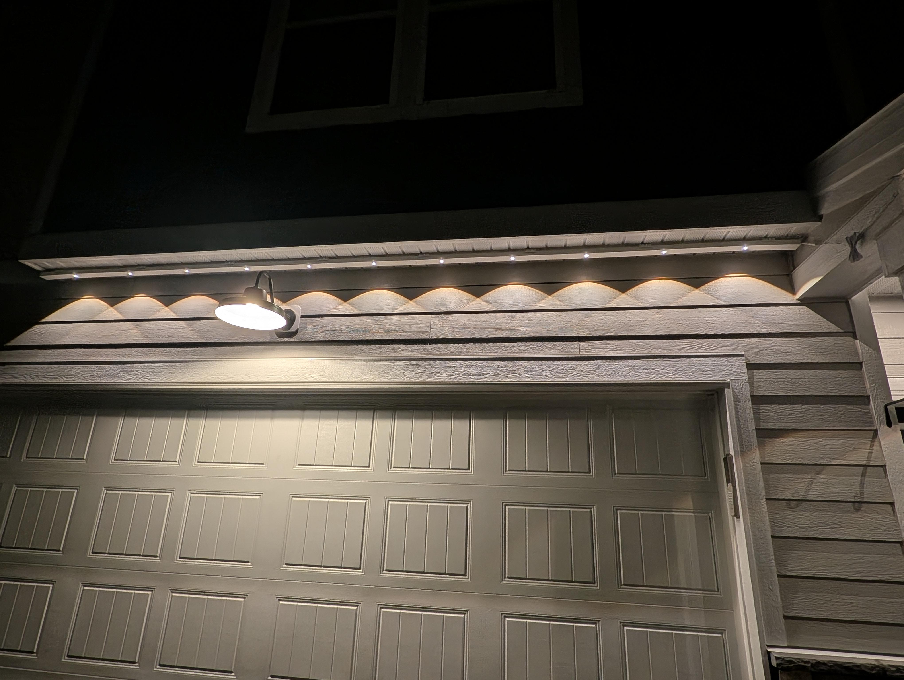

# Festavia Track – Modular Soffit Mount for Hue

Give Philips Hue Festavia permanent outdoor puck lights a straight, even line under your soffit. Enter the length of your eave, puck spacing and printer bed size. The model places the lights and brackets, numbers the track sections and packs them onto print plates.

## Make your track

1. Open **Festavia-Run** for a complete straight run. Measure from the outside face of one end cap to the other. Enter that length, your puck spacing and your usable bed dimensions in millimetres.
2. Select **Generate** and open **Assemble View** to see where each puck, joint and bracket lands. Download the plates for your printer. For a corner, plan each straight side separately and carry the cable between the two ends.
3. Open **Festavia-Section** for a replacement part or a small fit coupon. Check that a puck locks into its ring, the joint pins seat and the bracket lever closes.
4. Slice at **100% scale**. Choose PETG for the reference setup. Single-nozzle track sections print with their built-in breakaway ribs. Enable tree supports on the bracket and lever plates.
5. Assemble the numbered sections on a bench, then lift the track into the soffit brackets. Each seam takes two splice bars and two cross pins. Open the sliding levers to take the run down again.

At 16 in (406.4 mm) puck spacing on a 256 mm square bed, a **10 ft run** produces 8 puck positions, 18 sections and 9 plates. A **15 ft run** produces 11 puck positions, 27 sections and 12 plates. The downloadable 15 ft P1S project is a worked example.

## Optional cable management

Open **Festavia-Accessories** for the cable slack box and snap lid, the power-supply cradle and slide-on cover, siding shims, or flat-wire and round-cord clips. Pick only the parts your route needs. The cradle fits the 131 × 62 × 48 mm reference supply. Follow your supply’s mounting and airflow instructions.

The [complete download](https://raw.githubusercontent.com/Dyluhn/festavia-studio/track-downloads/v0.1.1/Festavia-MakerWorld.zip) includes an offline workbench, a [configuration guide](docs/Festavia-Configuration-Guide.pdf) and an [illustrated assembly manual](docs/Festavia-Assembly-Manual.pdf). The holder fits the Festavia permanent outdoor puck with a roughly 35 mm body and 49 × 20 mm mounting tabs.
