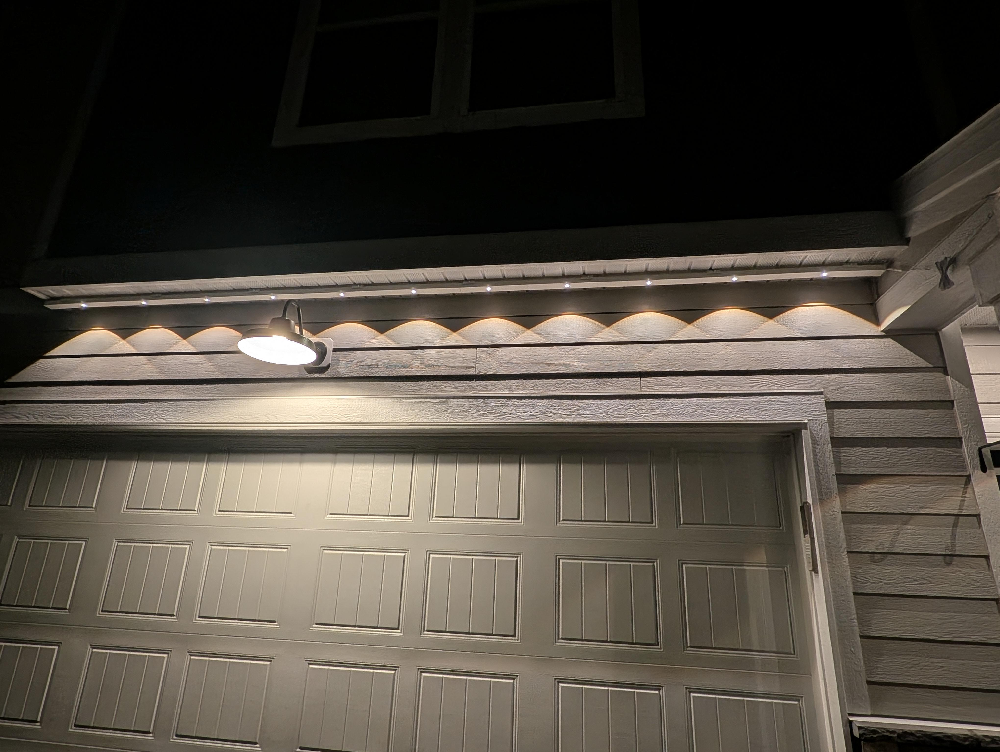
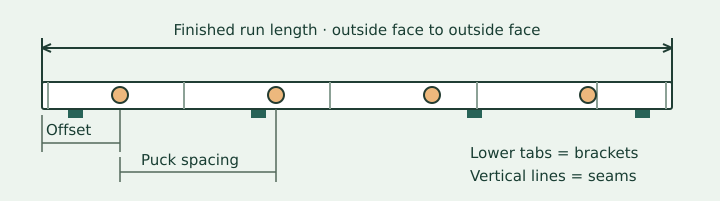
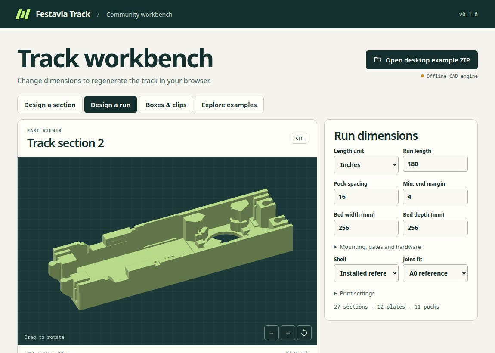
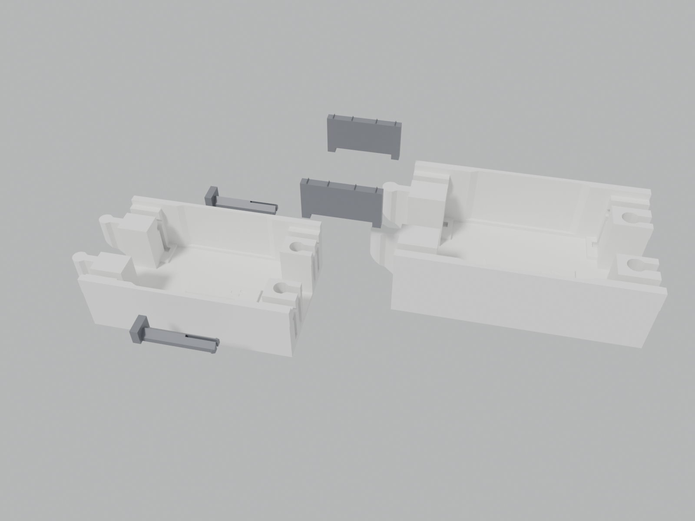

# Festavia Track

A customizable, modular soffit track for **Philips Hue Festavia permanent outdoor
puck lights**. Plan a straight run, print numbered sections, lock the joints with
replaceable splice bars and pins, then lift the run into sliding-lever brackets.

This is a mechanical mounting kit. It does not need an ESP32, Home Assistant or
a Hue integration. Independent community design; not affiliated with Signify.



## Build your first run

### 1. Measure one straight side

Measure the finished length **from the outside face of one end cap to the outside face of the other**. Use the left cap as your zero for bracket and puck positions. At a corner or roof change, measure a second supported run. Check that the puck has a roughly 35 mm body and 49 × 20 mm mounting tabs.



Write down the length, your chosen puck spacing and the usable width and depth of your printer bed. For example, a 15 ft run is **4,572 mm** and 16 in spacing is **406.4 mm**. Bed dimensions stay in millimetres in both designers. [Configuration guide with settings and examples (PDF)](docs/Festavia-Configuration-Guide.pdf)

### 2. Generate the numbered pieces

| Where to design | What to do |
| --- | --- |
| **MakerWorld** | Open the [model listing](https://makerworld.com/en/models/3665672-festavia-track-modular-soffit-mount-for-hue), select **Customize** and choose **Festavia-Run**. Enter dimensions in mm, select **Generate**, then check **Assemble View**. [Illustrated MakerWorld walkthrough](makerworld/README.md#try-it-online) |
| **Offline workbench** | [Download the kit](https://raw.githubusercontent.com/Dyluhn/festavia-studio/track-downloads/v0.1.1/Festavia-MakerWorld.zip), extract it and open `workbench/index.html`. Choose **Design a run**, enter your measurements and wait for the puck, section and plate totals. [Illustrated workbench walkthrough](workbench/README.md) |
| **Desktop exporter** | For a complete cut list, BOM and per-joint pin schedule, open the **Make Track** launcher in a [source checkout](https://github.com/Dyluhn/festavia-studio/tree/main/track) or the [desktop example archive](https://raw.githubusercontent.com/Dyluhn/festavia-studio/track-downloads/v0.1.1/festavia-track-0.1.0-community-beta.zip). [Desktop setup and export](docs/GETTING_STARTED.md#customize-your-run) |



With the pictured settings, expect **11 puck positions, 27 track sections and 12 plates**. To print a single replacement or check a joint fit, choose **Festavia-Section** in MakerWorld or **Design a section** in the workbench.

### 3. Slice and assemble

Open each generated 3MF in your slicer. Choose your printer and PETG profile, keep the parts at 100% scale, and use tree supports on the bracket and lever plates. In the supplied 15 ft P1S example, those are plates 8 and 9. Single-nozzle track sections have built-in breakaway ribs and print with slicer supports off.

Start with a joint and a puck holder. With the string unplugged, seat the puck, turn its ring and fit the stop pin. Join the numbered sections on a padded bench. Fit each seam with two splice bars and two cross pins. Transfer the bracket positions to the soffit, lift the track with its levers open, then close each lever. [Follow the illustrated assembly steps](docs/ASSEMBLY.md) · [Print the assembly manual (PDF)](docs/Festavia-Assembly-Manual.pdf)

### 4. Route the cable

Use the rectangular cable box for low-voltage slack, the arched cradle for a compatible factory power supply, and flat or round clips for exposed cable. Each base has its own cover. [Choose the parts and follow the installation pictures](accessories/README.md).

## What you can change

| Setting | Supported customization |
|---|---|
| Run length | 12–600 in / 304.8–15,240 mm per separately supported straight run |
| Light spacing | 12–21 in / 304.8–533.4 mm; excess factory cable stays loose in the channel |
| Placement | Automatic centered layout, or a measured first-light offset |
| Existing mounting holes | Optional exact bracket centres in mm; clearance/span rules still apply |
| Printer bed | 180–400 mm on each axis, including rectangular beds; no diagonal placement |
| Shell | Installed reference, full 3.2 mm reinforced shell, or custom 1.6–3.2 mm face / 1.8–3.2 mm side walls |
| Fit | A0 reference joints, or ±0.05 mm joint-fit variants for calibration |
| Printing | Single-nozzle breakaway supports, or original dual-material interface geometry |
| Ends and cable | Wire or blank gates; flat-wire and round-cord clips |

There is no hard-coded pack quantity. Light count follows run length, spacing and
end margins. For example, a 600 in run at 12 in spacing can plan 50 holders.
The software's geometry count does not authorize electrically extending a light
string: follow the light manufacturer's limits and installation instructions.

### The established joints, with optional extra reinforcement

The default retains the installed **A0 train-track joint**: two tongues, two splice
bars and two barbed cross pins per seam. The reinforced holder supports the lock
tabs that broke in the early design. Rings turn 20° and are secured by stop pins.



An optional full-shell profile increases the measured plain-section vertical
second moment of area by **68%**, with **79% more material area in that section**.
The comparison uses the cross section of the exported track. [Structure and material details](docs/STRUCTURE.md).

## Export a kit

From a clone of Festavia Studio, open the `track` directory before running the commands below.

With Python 3.12+ and OpenSCAD installed:

```sh
python make_track.py --config examples/garage-256.json --output my-track-output
```

On macOS/Linux the Python command may be `python3`. Or double-click the platform
launcher and answer its measurement prompts. To generate only the plan, add
`--plan-only`; this needs no third-party Python packages.

Your output contains:

- Numbered track STLs / 3MFs, one hardware model per type, and fit-first coupons.
- Packed plates, with their required quantities and small-part spares included.
- A cut list, hardware BOM, bracket/light layout, and per-joint pin directions.
- The exact saved configuration, model fingerprint, mesh checks and file hashes.

See [Customization](docs/GETTING_STARTED.md#customize-your-run) for OpenSCAD
Customizer presets, measured bracket positions and multi-run installations.

## Check your puck

The holder fits the Festavia permanent outdoor puck with a roughly 35 mm body
and 49 × 20 mm mounting tabs. Match that shape before printing. Festavia fairy
lights and globe strings use different mounts.

[Assembly](docs/ASSEMBLY.md) · [Validation](docs/VALIDATION.md) ·
[Design audit](docs/DESIGN_AUDIT.md) · [Contributing](CONTRIBUTING.md) · [MIT license](LICENSE)
