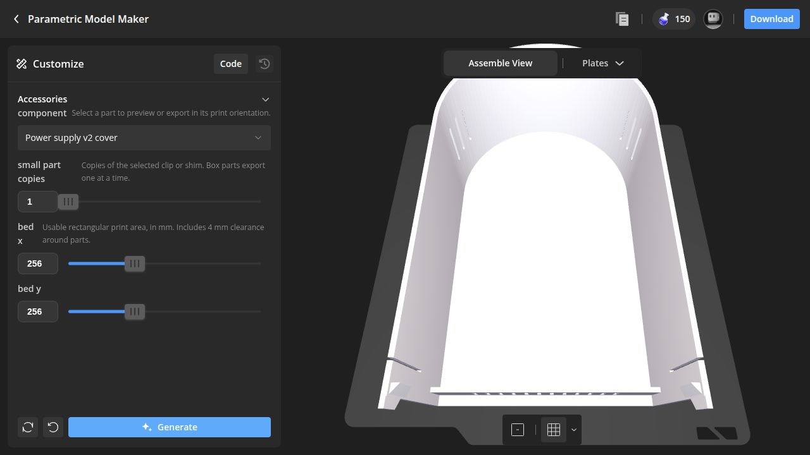

# Optional boxes and cable clips

Open **Boxes & clips** in the offline workbench or load **Festavia-Accessories.scad** in MakerWorld. Select a component, enter your usable bed size, preview it, then download. Export each base and its matching cover. The seven print-oriented STL files below also work directly in a slicer at 100% in millimetres. Track-only builds need none of these parts.

| Accessory | What to print | Other hardware |
|---|---|---|
| Cable slack box | 1 [base](parts/cable-base.stl) and 1 [v2 snap lid](parts/cable-lid.stl) | Two exterior #6 screws |
| Power-supply cradle | 1 [base](parts/psu-base.stl), 1 [plain v2 cover](parts/psu-cover.stl), up to 2 [siding shims](parts/siding-shim.stl) where needed | Two exterior #8 pan- or washer-head screws and two releasable ties |
| Exposed cable route | [Flat-wire clips](parts/flat-clip.stl) for the flat jacket, [round-cord clips](parts/round-clip.stl) for the round jacket | One exterior #6 screw per clip |

The **small rectangular cable box** stores excess low-voltage cable on two hooks. The v2 lid has two snap fingers, built-in end slots and optional scored exits. The **arched wall cradle** fits the reference sealed supply (nominal 131 × 62 × 48 mm) and uses a v2 cover that lowers approximately 9 mm to engage both latches. Its plain front retains the revised latch geometry. The small clips are the same designs offered by the run generator. Choose their quantities in one place.

The complete cable box fits a 180 × 180 mm bed. The PSU cover measures **142.8 × 241.9 × 87.4 mm** in print pose. Allow 4 mm around it for the selector's placement, plus any extra slicer clearance. A 256 × 256 mm bed fits both PSU parts. The selector can turn parts 90° on rectangular beds. It rejects an oversized box or too many copies. Leave all parts at their original size to preserve the latch and cable fits.

Use the diagrams and fastener sequence on pages 6–7 of the [assembly manual](../docs/Festavia-Assembly-Manual.pdf). Follow the supply’s instructions for mounting and airflow. If it requires open-air mounting, mount it separately and use the cable box for slack. Keep factory plugs and connectors intact and the outdoor outlet accessible. [Hue installation manual](https://www.assets.signify.com/is/content/Signify/046677607647-929004284701)
