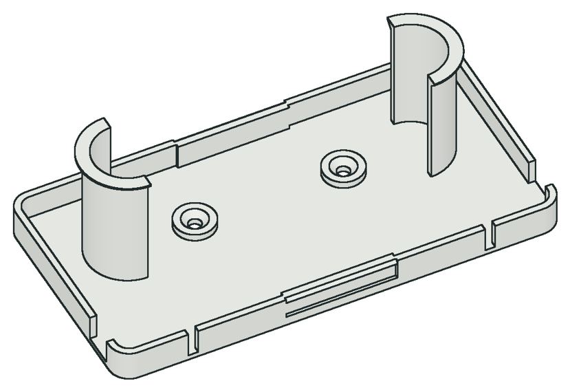
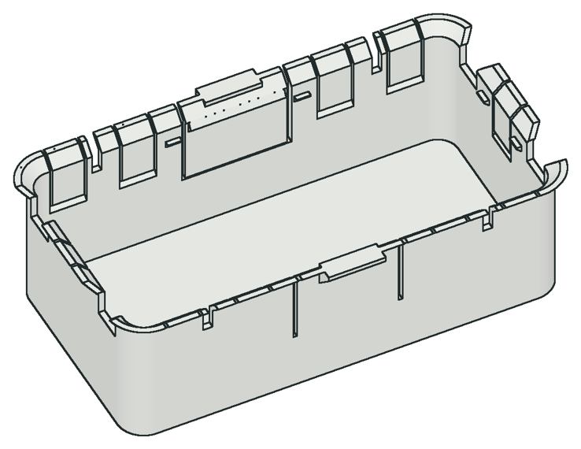
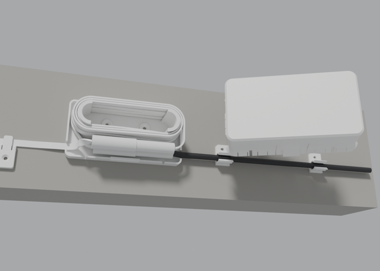
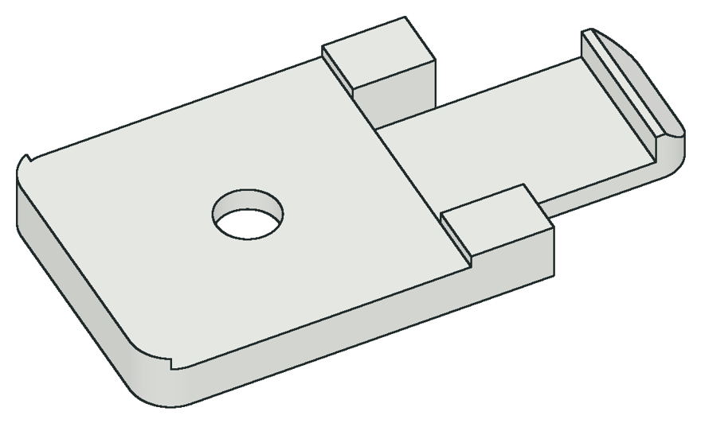
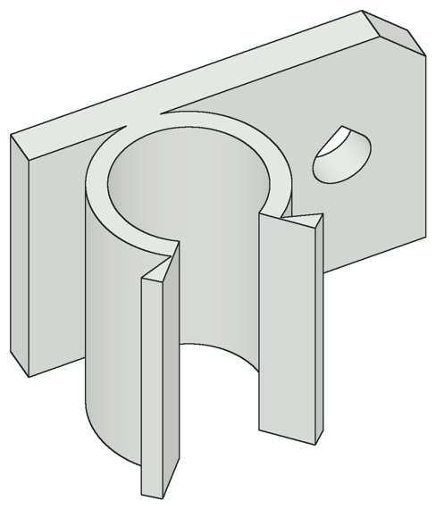
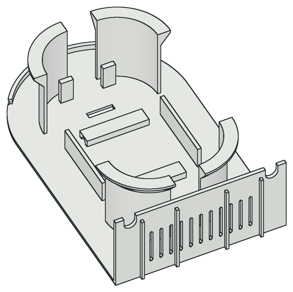
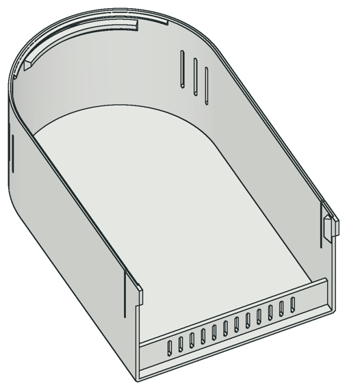
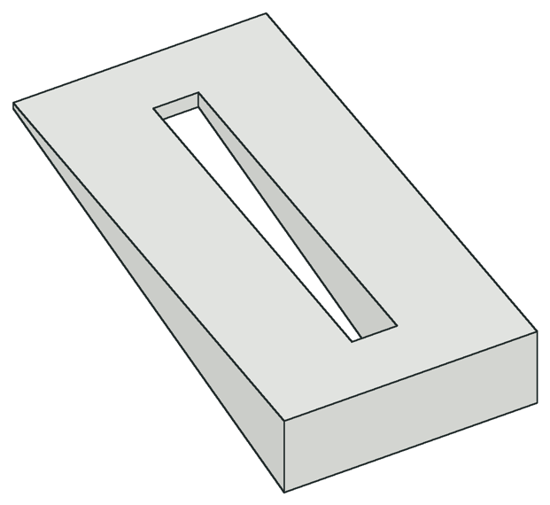
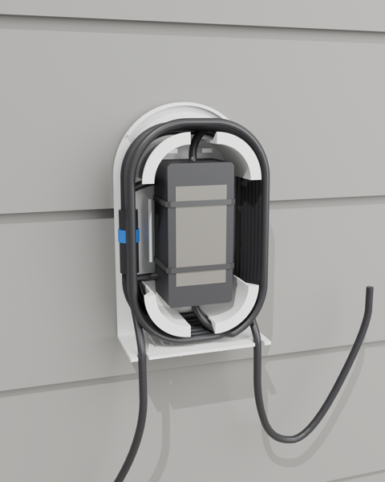

# Optional boxes and cable clips

Follow the cable from the track to the outlet. Use the **rectangular box** where you have extra low-voltage cable, **clips** along exposed lengths, and the **arched cradle** where you want to mount a compatible factory power supply. You can print each independently.

## Choose and print the parts

Open **Boxes & clips** in the [offline workbench](https://github.com/Dyluhn/festavia-studio/blob/main/track/workbench/README.md) or **Festavia-Accessories** in the [MakerWorld customizer](https://makerworld.com/en/models/3665672-festavia-track-modular-soffit-mount-for-hue). Select a part and quantity, enter your usable bed dimensions, then preview and download. For the original sizes, the STL links below open each part directly. Slice at 100% in millimetres so the latches and cable openings keep their fit.

| Accessory | What to print | Other hardware |
|---|---|---|
| Cable slack box | 1 [base](parts/cable-base.stl) and 1 [v2 snap lid](parts/cable-lid.stl) | Two exterior #6 screws |
| Power-supply cradle | 1 [base](parts/psu-base.stl), 1 [plain v2 cover](parts/psu-cover.stl), up to 2 [siding shims](parts/siding-shim.stl) where needed | Two exterior #8 pan- or washer-head screws and two releasable ties |
| Exposed cable route | [Flat-wire clips](parts/flat-clip.stl) for the flat jacket, [round-cord clips](parts/round-clip.stl) for the round jacket | One exterior #6 screw per clip |

The complete cable box fits a 180 × 180 mm bed. The supply cover measures **142.8 × 241.9 × 87.4 mm** in print position. Allow 4 mm around it for the selector’s placement plus your slicer clearance. A 256 × 256 mm bed fits both supply parts. The selector can rotate parts on a rectangular bed.

## 1. Store slack in the rectangular box

| Base with two winding hooks | Matching snap lid |
| --- | --- |
|  |  |

1. Unplug the lights. Lay the cable from the track’s wire gate to the box, leaving slack for turns and for access to the factory connector.
2. Face the drains down and fix the base to suitable backing with two exterior #6 screws. Loop the excess flat cable loosely around the hooks and keep the connector clear of the lid fingers, as pictured.
3. Route the cable through the existing end slots. If you need an alternate exit, remove the matching scored panel with the lid off and smooth the edge. Push the lid straight on until both fingers catch. Flex the thumb tabs outward to reopen it.

## 2. Clip the exposed cable

| Flat light cable | Round cord |
| --- | --- |
|  |  |

Lay out the route and mark it on flat backing. Fasten each clip with one exterior #6 screw clear of the wire. On a vertical face, place the fixed ears below the flat cable and slip the jacket sideways under the flexible arm. Press a matching round cord in from the open side. Check that the jackets keep their shape. If your run’s hardware plates already include the clips, count them toward this route.

## 3. Mount the factory supply in its cradle

| Wall plate and saddles | Slide-down cover | Optional siding shim |
| --- | --- | --- |
|  |  |  |

1. Compare your supply to the **131 × 62 × 48 mm** reference brick and check the lead exits. Leave about 10 mm above the arch and finger room at both lower sides. For powered use, fit the cover only if the supply manufacturer permits covered operation. If it requires open air, mount the supply in the open and use the separate slack box. Keep factory plugs intact and mains connections in their outdoor-rated enclosure. [Hue installation manual](https://www.assets.signify.com/is/content/Signify/046677607647-929004284701)
2. Fasten the wall plate through its two slots with exterior #8 pan- or washer-head screws into suitable backing. Use a shim under an unsupported screw on stepped siding. Thread two releasable ties through the saddles and seat the unplugged brick with its mains end up.
3. Facing the wall plate, route the outlet lead through the **right** slot and the low-voltage lead through the **left**. Leave a downward drip loop before the outlet as pictured. Keep the connector, outlet cover, vents and drains accessible.
4. Hold the cover about 9 mm above its final position, push it flat against the plate and slide it down until both latches catch. To remove it, press the two lower tabs outward, lift about 10 mm and pull forward.

For a printable copy of these steps, use pages 6–7 of the [assembly manual (PDF)](../docs/Festavia-Assembly-Manual.pdf).
