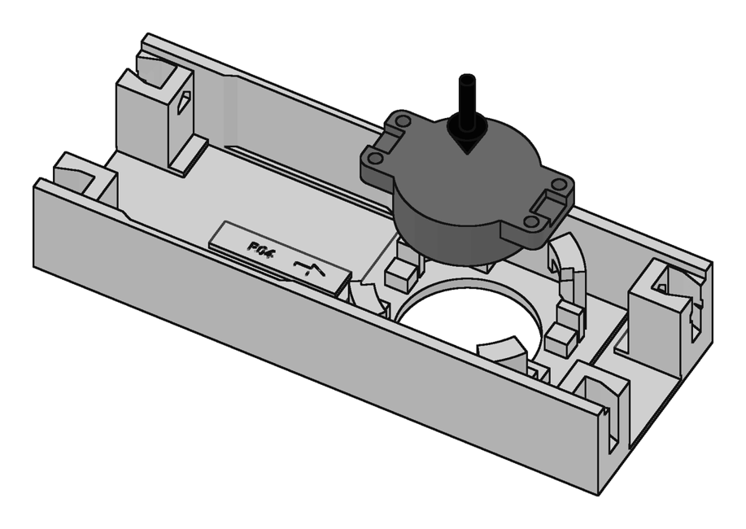
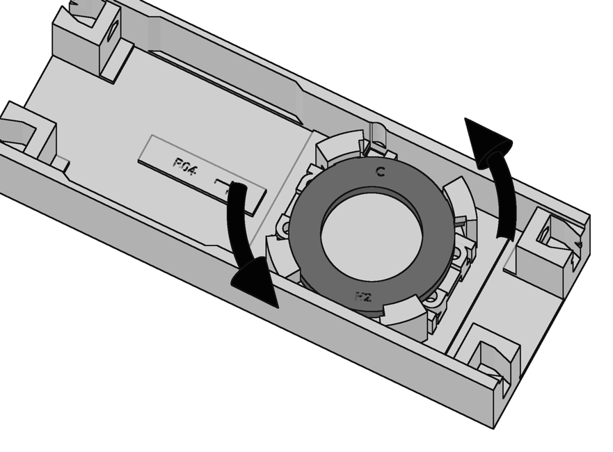
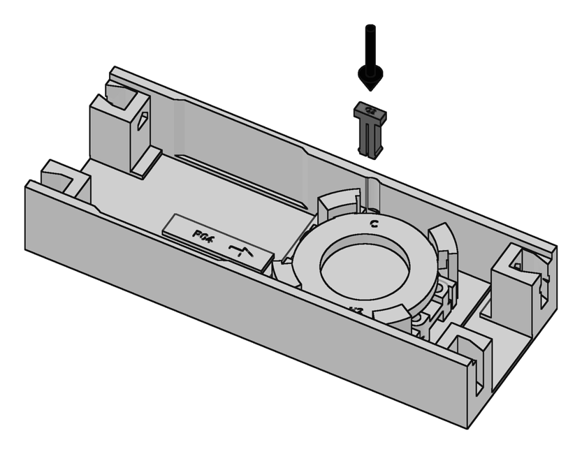
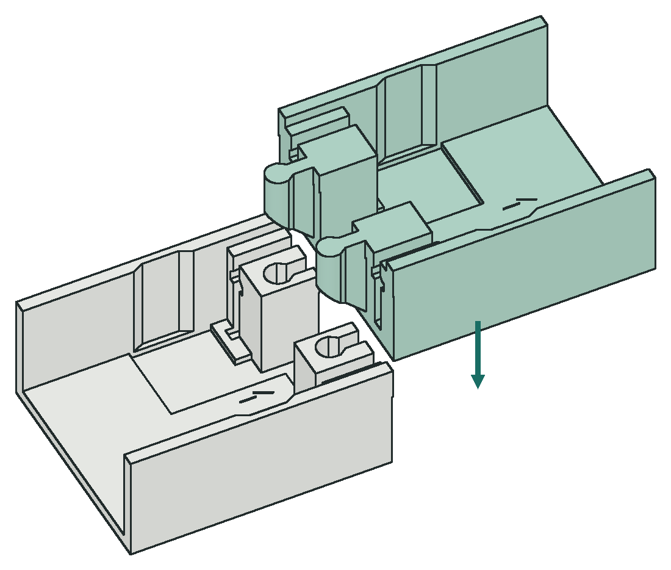
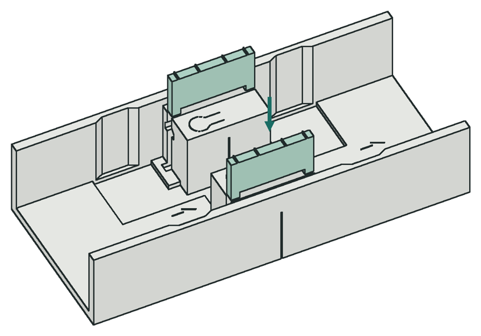
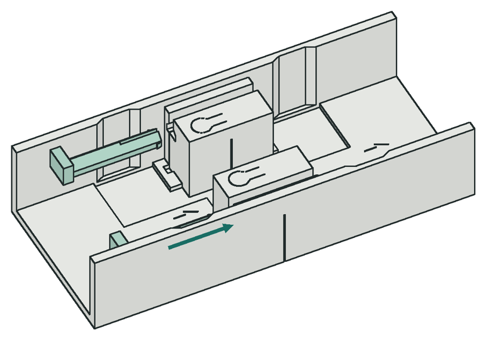
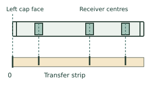
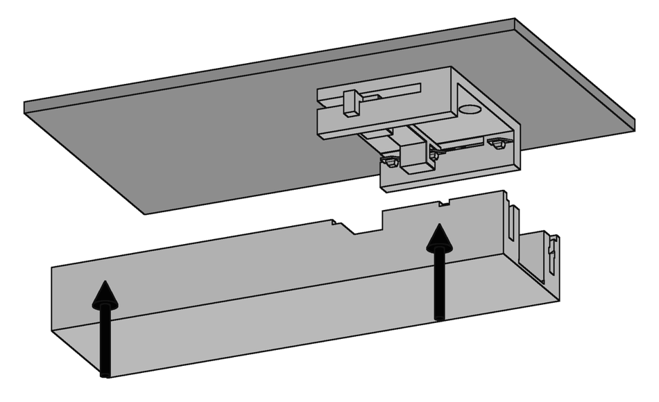
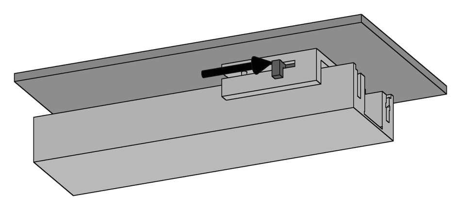

# Print and assemble

Use these pictures at the bench, or [download the seven-page assembly manual](Festavia-Assembly-Manual.pdf) to print. For the optional boxes and clips, follow the [accessory installation guide](../accessories/README.md).

## Fit first

In MakerWorld choose **Festavia-Section** and select a joint test or holder/receiver test under **Output**. A complete desktop export provides the following files. Print with the material, nozzle and layer height intended for your run:

1. `fit-first/joint-test.3mf`: two short track ends, two splice bars and two pins.
2. `fit-first/nozzle-test.3mf`: a holder section and receiver section with
   designed-in breakaway ribs. Add one ring, ring stop pin, bracket, lever and
   bracket stop pin from `parts/` to test their mating surfaces.

Supports are off for the two test plates. Use appropriate supports on the bracket
and lever parts. Break the thin ribs out of the holder and receiver from the open
channel side, then remove loose material. The ribs are sacrificial; the actual
lock tabs and slot roofs must remain intact.

The nozzle coupon always demonstrates the single-nozzle rib geometry. If your
run uses `single_nozzle=false`, also test a numbered holder and receiver section
from that run with the intended support interface; the coupon does not reproduce
the original unsupported overhang geometry.

Check:

- The tongue lowers into its socket without force. Both splice bars seat and both
  pins latch. The seam stays aligned when gently flexed by hand.
- The real, unpowered puck fits its holder. The ring turns through 20° and the
  stop pin keeps it from turning back. No tab cracks or excessive looseness.
- The receiver lifts into the bracket. The lever slides through its full 20 mm
  travel and latches; the captive stop keeps it from being lost.
- The cable can pass without being trapped by the ring, splice hardware or lever.

Record printer, material, nozzle, layer height, fit profile and pass/fail results
using `docs/FIT_REPORT.json`. A− and A+ adjust joint ribs/tunnel clearance by
0.05 mm; they do not calibrate every interface. Stop and revise a failed interface
before making all parts. Rib-release force and long-term outdoor behavior cannot
be inferred from a mesh check.

## Print the run

With MakerWorld, download each batch shown in **Assemble View** and print its packed plates once. With the desktop exporter, use the generated `PRINT-LIST.txt` and `bom.csv` and choose one printing method:

- **Packed plates:** print each plate once; its quantity already includes spares.
- **Individual parts:** print each numbered track once, and the `print_total`
  hardware quantities. Hardware STL/3MF files each contain one instance.

Do not print both sets. The example kits' numbers apply to those example
measurements, not a different run.

The large engraved number is inside each section, beside a direction arrow. The
visible face is down in the supplied track print pose. Parts generated by the
exporter have their bases at z=0. The cable channel faces the soffit when installed.

## Assemble on the bench

Work left to right as seen from the street, following the engraved numbers. Keep the string unplugged and lay the visible faces on a padded bench.

### Seat each puck and lock the ring

| 1. Seat the puck | 2. Turn the ring | 3. Fit the stop pin |
| --- | --- | --- |
|  |  |  |

Guide the lens through the opening, align the ring tabs with the gaps and seat the ring flat. Looking into the open back, turn the ring **20° counterclockwise** to its stop. Press in the ring stop pin and check that the ring cannot turn back. Leave cable slack loose down the middle of the channel.

### Join two sections

| 1. Lower the tongues | 2. Seat both bars | 3. Slide in both pins |
| --- | --- | --- |
|  |  |  |

Lower the next section’s left tongues into the previous section’s right sockets. Press one bar into each side slot, legs down. Insert both cross pins lengthwise **from the same numbered section** until the barbs catch. The desktop kit names that piece in `assembly.csv`. With MakerWorld, use the side with more clearance to the nearest puck or receiver. A side with no feature is clear. For equal clearances use the left section. Check the insertion path before seating the pins.

Slide a cap onto each end. Fit a slotted gate where the cable enters or exits and a blank gate at a closed end. Keep the factory connectors accessible.

The joint has a deliberate 0.4 mm seam. Do not glue or force the seam closed.
Crush ribs seat on first assembly, so reassembled joints may feel different.
Inspect them and replace damaged bars/pins before reuse.

## Mount the run

1. Mark the **outside face of the left cap** and each receiver centre on a nonstretch strip laid along the assembled run. Transfer the marks to sound backing with the same left-hand zero. A desktop kit also lists these positions in `layout.svg` and `plan.json`.
2. Use two exterior screws per bracket and two per end cap. CAD has 4.6 mm through
   holes/slots and 9 mm bracket-head recesses. A suitable approximately 4 mm shank,
   head no larger than 8.5 mm and head height no greater than 3.8 mm leaves fit
   clearance. Select screw length/anchorage for the actual backing.
3. Install brackets with their arrows matching the track and levers open. Lift
   the run into every bracket with enough help to prevent bending the assembly.
4. Slide every lever to the locked position; check each latch and captive stop.
   Secure the end-cap ears. Confirm the cable is free and every puck is retained.
5. Power and check the lights using their normal Hue setup.

Place brackets at most 24 in apart and within 8 in of each end. Fasten into solid
backing behind the soffit. Keep electrical connections in their factory housings
and follow the manufacturer’s cable and connector instructions.

## Corners and take-down

At corners or a change of roof plane, finish one supported straight run with a
wire gate and begin another. Leave the approved cable transition loose and
accessible. A rigid printed bridge across independently moving runs is not
included in this kit.

For removal, support the run, remove the end-cap screws, open all levers and lower it onto the bench.
Working from the last piece backward, squeeze the cross-pin barbs, withdraw the
pins, lift the splice bars and then lift the tongue piece. Avoid prying the light
tabs. Replace cracked, distorted or worn locking parts.
