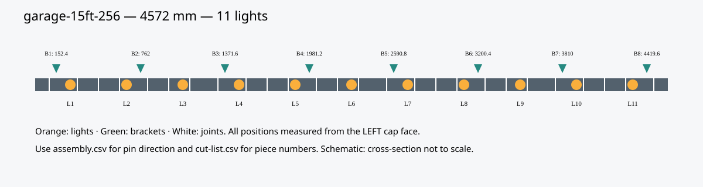

# Make a track for your run

Start with the [parametric configuration walkthrough](Festavia-Configuration-Guide.pdf) or the [illustrated steps on GitHub](../README.md#build-your-first-run). It covers measurement, two worked bed sizes, MakerWorld exports and the optional accessories.

## Choose the route

Each run is straight and independently supported. Measure from the outside face
of one end cap to the outside face of the other. Plan bends, corners and roof
changes as separate straight runs, each with its own end caps and brackets.
Join the lights using their approved cable/connector arrangement and leave an
accessible loose cable transition. This kit does not include a load-bearing
corner joint or a new electrical extension system.

The track is 56 mm wide and 28 mm deep. The bracket's soffit plane is 38 mm above
the visible track face. Check that the soffit has enough room for the bracket,
end-cap ears, cable route and access to the levers. Mount into sound backing.

The manufacturer's listed puck spacing is **22.4 in**, approximately 569 mm.
The supported track spacing is shorter, leaving slack between holders. At 16 in
centres there is about 163 mm of extra cable per gap. Keep it in the channel's
middle, away from the locking parts. Verify routing with your actual string
before committing to a large print. See the [Hue product specification](https://www.philips-hue.com/en-us/p/hue-white-and-color-ambiance-festavia-permanent-outdoor-lights-150-ft-white-string/046677607647).

## Use ready-made files

The [desktop example archive](https://raw.githubusercontent.com/Dyluhn/festavia-studio/track-downloads/v0.1.1/festavia-track-0.1.0-community-beta.zip) contains the `printable-examples/` directory. It includes a 15 ft / 16 in
spacing example for a 256 mm bed and a 10 ft example for a 180 mm bed. These are
complete example runs, not universal tracks that must fit every house.

| Example folder | Run | Holders | Track pieces | Packed plates |
|---|---|---:|---:|---:|
| `garage-15ft-256` | 15 ft, 16 in spacing, 256 mm bed | 11 | 27 | 12 |
| `small-bed-10ft` | 10 ft, 16 in spacing, 180 mm bed | 8 | 24 | 15 |
| `reinforced-15ft` | 15 ft, full 3.2 mm shell, 256 mm bed | 11 | 27 | 12 |
| `metric-5m` | 5 m, 400 mm spacing, 256 mm bed | 13 | 25 | 13 |
| `large-bed-25ft` | 25 ft, 16 in spacing, 350 × 320 mm bed | 19 | 38 | 14 |

Each example also has two additional fit-test plates. These counts illustrate
automatic scaling; they are not requirements for a different measured run.

1. Open that example's `config.json` and `layout.svg` and confirm the measurements.
2. Print its `fit-first/` coupons and the mating ring/bracket/lever parts.
3. After the fit check, print either the `plates/` files or the `parts/` quantities
   in `bom.csv`. Plate files already include the parts and spares.
4. Use [Assembly](ASSEMBLY.md) and the generated pin-direction schedule.

Every hardware STL is **one instance**. Its BOM row tells you how many to print.
Every packed plate already contains multiple instances; do not multiply those
quantities again. The two fit plates are extra calibration pieces.
The spare percentage applies to small pins and splice bars, with a minimum of
two extras when enabled. Set `spare_percent` to `0` to omit spares.

## Customize your run

### Guided export: complete kit in one operation

Install [OpenSCAD](https://openscad.org/downloads.html) and
[Python 3.12 or newer](https://www.python.org/downloads/). Extract the entire
distribution to a writable folder. Open:

| Computer | Launcher |
|---|---|
| Windows | `Make Track Windows.cmd` |
| macOS | `Make Track macOS.command` in Terminal |
| Linux | `sh "Make Track Linux.sh"` |

The launcher asks for your run measurements and printer bed, saves them to a JSON
file, then generates the kit. It creates a `.venv` in the extracted folder and
downloads the pinned geometry packages on the first full export. The computer
needs internet for those initial downloads. Planning alone uses Python's
standard library and OpenSCAD.

If OpenSCAD is not found automatically, specify its executable:

```sh
python make_track.py --openscad "/path/to/openscad" --config examples/garage-256.json --output my-run
```

Windows OpenSCAD commonly provides `C:\Program Files\OpenSCAD\openscad.com`.
On macOS its application executable is commonly
`/Applications/OpenSCAD.app/Contents/MacOS/OpenSCAD`.
The output folder must be new; existing folders are never overwritten.

### Read the plan before printing

To preview the included 15 ft example, run this from the track directory and open `my-preview/layout.svg` in a browser.

```sh
python make_track.py --config examples/garage-256.json --plan-only --output my-preview
```



The first bracket in this example sits **152.4 mm from the left cap face**. Read the other green bracket labels from the same end. Orange circles show the pucks and white ticks show the seams. Look up each section in `cut-list.csv` and its pin direction in `assembly.csv`. To make printable files, run the command again without `--plan-only` and give it a new output folder.

### Saved configurations

Copy a file in `examples/`, change its name and measurements, then run:

```sh
python make_track.py --config my-run.json --output my-run-output
```

The examples cover 180 mm and 256 mm beds, a larger rectangular bed, metric
measurements and the reinforced shell. Field names must be exact; unknown fields,
unsafe values, wrong boolean types and nonfinite numbers are rejected.

All run measurements follow `length_unit`. Bed dimensions, shell thicknesses,
`support_gap` and `bracket_centres_mm` are always millimetres.
When changing inches to millimetres, update the run, light spacing, margins,
bracket limits and any active first-light offset together.

For **existing lights and mounting holes**, use:

```json
{
  "schema_version": 1,
  "name": "measured-run",
  "parameters": {
    "run_length": 180,
    "light_spacing": 16,
    "light_placement": "fixed",
    "first_light_offset": 10,
    "bracket_centres_mm": "152.4,762,1371.6,1981.2,2590.8,3200.4,3810,4419.6"
  }
}
```

The planner preserves those light/bracket positions exactly and checks whether
pieces, joints and pin access can fit around them. It refuses incompatible
measurements rather than moving your mounting holes silently.
Blank bracket positions enable automatic planning. Automatic light placement may
shift the centered light set within its spare end margins to preserve every
holder on small beds. The diagram records the resulting positions.

### OpenSCAD Customizer: no Python required

Open `festavia_track.scad`. Keep `festavia_track.json` beside it to use the example
presets. Select Run, Printer, Fit and Structure settings, then choose a numbered
piece, hardware part or **Print plate N**. Render with F6 and export the geometry.
The console echoes the full BOM and plan on every render. The optional 3D BOM card
is slower on OpenSCAD 2021.01's CGAL backend; the Python planner writes readable
CSV/text without rendering that text mesh.

### Bambu MakerWorld

The [MakerWorld guide](../makerworld/README.md) includes two standalone SCAD files. Open one through **Creator Portal → Open SCAD File**. Generate a section or fit coupon, or enter run and bed dimensions to export packs of up to 16 plates. The HTML workbench can save your edited design for the same online controls.

## Print settings

Use PETG for the established reference fit. Do not use the included geometry as
pre-sliced machine instructions. Choose your printer, nozzle and material profile
in your own slicer, inspect layer preview and slice there.
The tallest supplied print orientation needs 60 mm of usable Z height.

| Parts | Starting settings | Supports |
|---|---|---|
| Track | 0.20–0.28 mm layers, 3–4 walls; start with 10–15% infill | Off for `single_nozzle=true`; remove the designed-in ribs |
| Splice bars, cross pins, rings, stop pins | 0.20 mm layers, 4 walls, 35% infill | Off |
| Bracket and lever | 0.20 mm layers, 4 walls, 35% infill | Tree supports as needed; inspect the pawl and guide surfaces |
| Caps, gates, clips | 0.20 mm layers, 3–4 walls | Off |

These are starting settings for a fit test. The installed reference used 0.28 mm,
2-wall track pieces and a dual-material support interface on light/mount pieces.

Use the exporter-generated **3MF** when printing a packed plate: components are
named `track-…`, `bracket-…`, `lever-…`, etc., so you can apply support settings to
the bracket and lever objects separately. STL plates merge their parts into one
mesh; use the individual STLs if your slicer cannot separate per-object settings.
Bracket/lever plates have extra support clearance and are kept separate from
support-free hardware plates. Custom support/brim settings may need more room;
inspect the complete toolpaths before printing.

For `single_nozzle=false`, holder/mount overhangs need a suitable support strategy.
The original PETG/PLA contact interface required a second nozzle. Do not assume
supports-off settings also apply to that original geometry.

## If generation stops

- **No valid layout:** check units first, then the light spacing and end margins.
  Exact measured bracket positions may conflict with a holder or pin approach.
  The input range starts at 12 in, but some short layouts cannot accommodate
  the holders, brackets, joints and pin access together.
  Plan separate supported runs or change measurements deliberately.
- **Too many brackets:** some layouts need a bracket between each pair of lights
  to keep the mechanical windows clear. The planner prioritizes valid geometry,
  not a globally minimal screw count. Use the generated BOM; do not omit supports.
- **Output already exists:** use a new output name. Completed kits have
  `manifest.json` with `complete: true`; interrupted builds do not.
- **Package download fails:** use the OpenSCAD Customizer path, or install the
  pinned requirements into your own Python environment and run `tools/trackkit.py`.
- **Fit too tight/loose:** follow the fit-first checks before changing only the
  joint-fit profile. That setting does not resize the puck bore or bracket.

For developers, see [Validation](VALIDATION.md) and [Contributing](../CONTRIBUTING.md).
