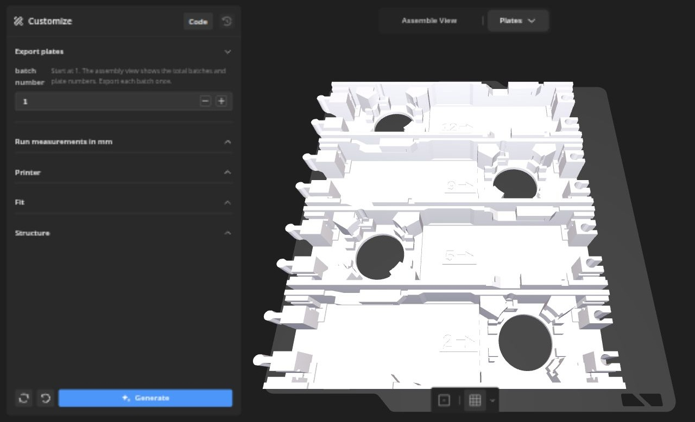

# Customize your Festavia track on MakerWorld

[Configure your track (PDF)](../docs/Festavia-Configuration-Guide.pdf) · [Assembly picture manual (PDF)](../docs/Festavia-Assembly-Manual.pdf) · [Phone-friendly configuration](../docs/Festavia-Configuration-Guide.html) · [Phone-friendly assembly](../docs/Festavia-Assembly-Manual.html)

For Philips Hue Festavia permanent outdoor puck lights. Start with the **section** to check the fit on your printer. Choose the **run** to lay out a complete straight soffit, including its brackets, end caps and joint hardware.

| What you want | File to open in MakerWorld | What to change |
|---|---|---|
| Print a fit test or design one section | [Festavia-Section.scad](Festavia-Section.scad) | Under **Output**, select a joint test, holder/receiver test or track section. Under **Track section**, set length in mm, end types and puck or bracket position. **Structure** controls the walls. |
| Make an entire straight run | [Festavia-Run.scad](Festavia-Run.scad) | Under **Run measurements in mm**, enter the cap-to-cap length and puck spacing. Under **Printer**, enter your usable bed width and depth. The planner determines the number of pucks, numbered sections and plates. |
| Add a box or clips | [Festavia-Accessories.scad](Festavia-Accessories.scad) | Choose each base and matching cover, optional shims, or copies of a flat or round clip. Enter the usable bed size. [Parts and fasteners](../accessories/README.md). |

## Try it online

Open [Festavia Track on MakerWorld](https://makerworld.com/en/models/3665672-festavia-track-modular-soffit-mount-for-hue) and select **Customize**. To load a downloaded SCAD file with your own settings, use the Creator Portal steps below.

1. Sign in to [MakerWorld Parametric Model Maker](https://makerworld.com/en/makerlab/parametricModelMaker). Choose **Creator Portal → Open SCAD File** and select one of the files above. Close the **Code** drawer with its × to see the model and controls together.
2. Edit a measurement and select **Generate**. To try a section, change **piece length** from 180 to 207.5 mm. Both use the same puck opening and joint. The printed overall length includes the projecting tongue.
3. For a run, **Assemble View** shows a diagram and the number of batches. **Plates** opens the printable layouts. The orange dots are pucks and the lower teal marks are brackets. The vertical lines are track joints.
4. Select **Download**, choose the printer that matches your bed dimensions, then **Confirm**. When the design is ready, choose **Download** again. The section offers STL and 3MF. A run downloads as a Bambu Studio 3MF containing up to 16 packed plates by default.
5. If **Assemble View** shows a single batch, the download is the whole run. For more than 16 plates, save the file with its batch number. Increase **Export plates → batch number**, select **Generate**, and download again until you reach the count shown in **Assemble View**. Plate numbers in each 3MF start at 1. The diagram gives their positions in the full run. Keep the dimensions and fit settings consistent across batches.

For example, 4,572 mm at 406.4 mm puck spacing on a 256 × 256 mm bed gives **11 pucks, 27 sections and 12 plates** in one download. Changing just the run length to 3,048 mm gives **8 pucks, 18 sections and 9 plates**. All nine fit in one file. To split that same run into smaller downloads, choose **Up to 4 plates**. Batch 3 then contains only the ninth plate.

## Print the fit test first

Open the 3MF in Bambu Studio, select your actual printer, plate and filament, and check the layer preview. The tested P1S download came with a 0.4 mm nozzle and **PLA** selected. Choose the intended **PETG** profile for the reference fit. With single-nozzle ribs enabled, the track prints supports-off. Brackets and levers have their own plates and need tree supports. For the 4,572 mm reference run, enable tree supports on plates 8 and 9. The joint coupon checks the splice bars and cross pins. The holder/receiver coupon checks the breakaway ribs and fit with your puck, ring and lever. The [assembly guide](../docs/ASSEMBLY.md) covers fitting and fastening.

## Take an offline design online

In the [HTML workbench](../workbench/index.html), choose **Design a section** or **Design a run**, enter your dimensions, then select **Save MakerWorld model**. Import that file through **Open SCAD File**. The design opens with your settings as editable defaults. Run lengths entered in inches transfer as millimetres. Saving a run exports the complete parametric plan beginning with batch 1, whichever part is on screen. The existing run JSON export also produces a configuration for the desktop kit builder and its cut list and assembly schedule.

## For the community listing

Upload the three SCAD files and the example 3MF as **Raw Model Files**. Use **Add Documentation → Assembly Guide** for the two PDFs. Host the complete ZIP as the [track downloads branch](https://github.com/Dyluhn/festavia-studio/tree/track-downloads) and link it in the description. MakerWorld rejected the raw-model ZIP when it encountered the bundled LICENSE file. Keep the license and offline workbench in the community download.

Maintainers can regenerate the accessory selector with <code>python3 makerworld/build_accessories.py</code>. Regenerate the run and section upload files with `python3 makerworld/build.py` from the track directory. All track geometry and packing come from the community OpenSCAD model. Package the community download with <code>python3 makerworld/package.py --reference-3mf examples/Festavia-15ft-P1S.3mf --output Festavia-MakerWorld.zip</code>.
