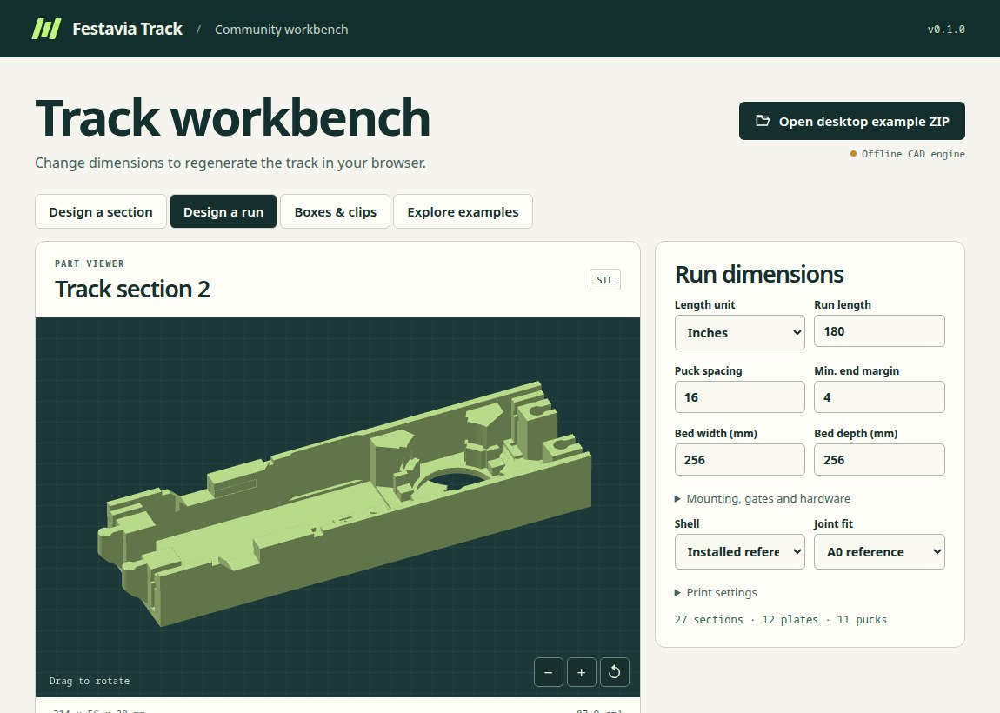

# Offline parametric workbench

## Design a run in your browser

1. [Download the complete kit](https://raw.githubusercontent.com/Dyluhn/festavia-studio/track-downloads/v0.1.1/Festavia-MakerWorld.zip), extract it, then open `workbench/index.html` in a browser. The **Open desktop example ZIP** button is for inspecting the separate example archive. You can begin a new design immediately.
2. Select **Design a run**. Choose inches or millimetres for your run and puck spacing, then enter your bed width and depth in mm. The preview regenerates when you change a value. If the form reports a fit error, correct the indicated dimension before exporting.
3. Check the section, plate and puck counts under **Run dimensions**. Scroll to **Assembly layout** for the puck, bracket and joint positions. In the worked example below, `180` inches at `16` inch spacing gives 11 pucks, 27 sections and 12 plates on a 256 mm square bed.



### Save the right file

| What you want | What to select |
| --- | --- |
| One printable part or plate | In the part viewer select the numbered section, hardware part or packed plate, then **Download STL**. That STL contains the selected geometry. |
| The complete run as a Bambu Studio print project | **Save MakerWorld model**. Import the saved SCAD file in MakerWorld using **Creator Portal → Open SCAD File**, then **Generate** and download every plate batch. [MakerWorld walkthrough](https://github.com/Dyluhn/festavia-studio/blob/main/track/makerworld/README.md#try-it-online) |
| Editable dimensions and a full desktop kit | **Save run JSON**. Use that JSON with `make_track.py --config` in the desktop exporter to generate the packed plates, cut list and assembly schedule. [Desktop instructions](https://github.com/Dyluhn/festavia-studio/blob/main/track/docs/GETTING_STARTED.md#saved-configurations) |
| A replacement part or a cable organizer | Choose **Design a section** to edit one section in mm, or **Boxes & clips** to choose one accessory, its quantity and your bed size. Preview and download the selected STL. |

Once you have your plates, follow the [illustrated assembly steps](https://github.com/Dyluhn/festavia-studio/blob/main/track/docs/ASSEMBLY.md).

The HTML includes the v0.1.0 model, sample data, a WebAssembly OpenSCAD runtime, and the Liberation Sans Bold font used to engrave part numbers. Edits run in a cancellable local worker. The installed puck bore and bracket mechanism remain fixed by the source model.

## Rebuild

Download the [original example archive](https://raw.githubusercontent.com/Dyluhn/festavia-studio/track-downloads/v0.1.1/festavia-track-0.1.0-community-beta.zip). From this directory, run:

```sh
npm ci --ignore-scripts
python build.py /path/to/festavia-track-0.1.0-community-beta.zip index.html
```

The build verifies the input archive and runtime fingerprints. It adapts the runtime wrapper's module export and module URL for a classic worker to allow opening from file://. The WASM binary is unchanged. The engine is [openscad-wasm 0.0.4](https://www.npmjs.com/package/openscad-wasm/v/0.0.4), distributed under GPL-2.0; upstream [engine sources and build scripts](https://github.com/openscad/openscad-wasm) and [OpenSCAD source](https://github.com/openscad/openscad). Liberation Sans is distributed under the SIL Open Font License. Both license texts are in vendor/ and embedded in the HTML.
